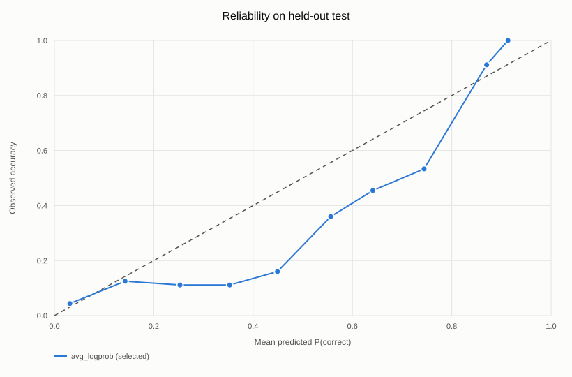
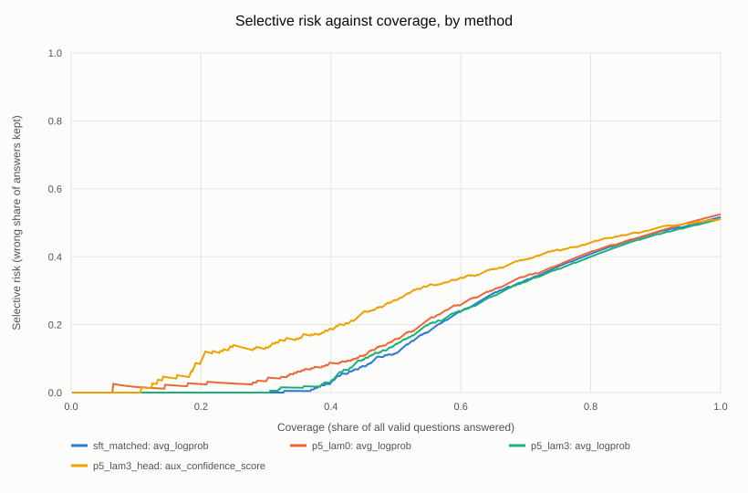

# Confidence and calibration

**Question.** Can cheap signals from the model's own output tell us when an answer is wrong, and do they mean what they appear to mean?

**Short answer.** They rank answers well on average, but they do not reliably flag weak knowledge. On synthetic facts `avg_logprob` reaches AUROC 0.954, and that ranking mostly separates facts the model learned from facts it did not. Among answers the model never gets right (K=0), it does not separate the few right answers from the wrong ones. At 80% coverage, 71% of wrong answers still pass the threshold. Raw signals are also badly calibrated: calibration cuts ECE from 0.287 to 0.086, but the mapping does not carry over from real questions to synthetic ones. On real questions the numbers so far are from validation; the locked test has not been run.

## Status of these results

| Result | Status |
|---|---|
| Synthetic `main_v0`: `sft_matched`, P5 λ=0, P5 λ=3 | Final split evaluated once, after the policies were committed |
| TriviaQA base model | **Development only.** Selected on validation, so its numbers are optimistic until the locked test |
| TriviaQA locked test | Not run. Waiting for the freeze and the team's 5 Nov decision |
| "I don't know" baseline, K(q) method | Not included. Float32 responses are not available yet |

## Method

**Protocol.** Everything follows the team decisions of 31 Oct: float32, `prompt_v0`, `decoding_v1`, and the shared grader `p2_whole_word_v5`. Every row is regraded on loading, whatever label it arrived with. The P5 files arrived graded with v4; the regrade changed 0 outcomes.

**Target.** The answer being judged is the greedy response. The five sampled responses are separate draws, so using their agreement to predict the greedy answer is not circular.

**Signals.** Defined in [`confidence_calibration/README.md`](../confidence_calibration/README.md). They use the model's raw logits, never the likelihood of the reference answer, so each could be used at inference.

**Stages.**
1. *Fit:* one Platt mapping from each signal to P(correct), on training rows only.
2. *Select:* the signal with the lowest validation Brier score, and a threshold for each coverage target, on validation only.
3. *Freeze:* every choice is written to `frozen_policy.json`.
4. *Evaluate:* the file is applied unchanged, once.

Held-out rows are removed by split label before any outcome or signal is read, and tests confirm that scrambling them leaves the policy byte-identical. TriviaQA uses `train_probe` and `validation`. Synthetic data divides dev facts 70/30 within each exposure level and holds out `final`. Paraphrases of a fact stay together.

**Denominators.** These decide what each number means.

| Metric | Denominator |
|---|---|
| AUROC, AUPRC, Brier, ECE | Attempted greedy answers with a usable signal; abstentions are excluded |
| Coverage, accuracy, hallucination | All valid questions, abstentions included |
| Selective accuracy, selective risk | Answers kept by the policy |
| Confident errors | Wrong answers at or above the frozen threshold |

Abstaining on a low score is an **inference policy**, not something training taught the model. A method that answers less can look safer without being better, so methods are compared at matched coverage.

**Uncertainty.** Intervals are 95% percentile bootstraps, resampling facts on synthetic data and questions on TriviaQA.

**Scoring check.** TriviaQA signals were computed on the Mac in float32 and compared with P2's values recorded at generation. The median log-probability gap is about 0.000001, and 698 of 700 greedy answers agree within 0.01. The other 2 are wrong answers whose text does not round-trip through the tokenizer exactly. K matches P2's labels on all 200 validation questions checked.

## Results

### Synthetic facts: the signals rank well

`sft_matched`, 600 final questions (290 right, 310 wrong). Differences are against `avg_logprob` on the same questions.

| Signal | AUROC [95% CI] | Difference [95% CI] | Brier | ECE | ECE read raw |
|---|---:|---:|---:|---:|---:|
| `avg_logprob` | 0.954 [0.933, 0.973] | reference | 0.087 | 0.086 | 0.287 |
| `entropy` | 0.939 [0.915, 0.961] | -0.015 [-0.027, -0.006] | 0.103 | 0.102 | N/A |
| `consistency` | 0.923 [0.897, 0.949] | -0.031 [-0.052, -0.010] | 0.102 | 0.072 | 0.145 |
| `majority_frac` | 0.921 [0.893, 0.946] | -0.033 [-0.055, -0.012] | 0.096 | 0.052 | 0.208 |

Always predicting the base rate gives Brier 0.250, so every signal adds real information. `sum_logprob`, `min_logprob` and `first_token_entropy` need the adapters to compute and are not included here. *ECE read raw* treats the signal itself as a probability, so the drop from 0.287 to 0.086 is what calibration adds.



### Real questions: weaker, and `min_logprob` leads so far

TriviaQA base model, **validation only**: 200 questions, 182 attempted (47 right, 135 wrong), 18 abstentions.

| Signal | AUROC [95% CI] | Difference [95% CI] | Brier | ECE | ECE read raw |
|---|---:|---:|---:|---:|---:|
| `min_logprob` (selected) | 0.827 [0.756, 0.888] | +0.081 [-0.003, +0.165] | 0.149 | 0.064 | 0.068 |
| `sum_logprob` | 0.777 [0.703, 0.842] | +0.030 [-0.052, +0.117] | 0.166 | 0.088 | 0.195 |
| `entropy` | 0.771 [0.689, 0.848] | +0.024 [-0.007, +0.058] | 0.172 | 0.079 | N/A |
| `avg_logprob` | 0.747 [0.662, 0.831] | reference | 0.174 | 0.076 | 0.450 |
| `majority_frac` | 0.678 [0.592, 0.764] | -0.069 [-0.154, +0.024] | 0.181 | 0.079 | 0.125 |
| `consistency` | 0.677 [0.587, 0.762] | -0.070 [-0.161, +0.026] | 0.180 | 0.072 | 0.154 |
| `first_token_entropy` | 0.668 [0.577, 0.756] | -0.079 [-0.182, +0.018] | 0.187 | 0.078 | N/A |

The base-rate Brier is 0.196. No interval on a difference excludes zero, so this does not establish that `min_logprob` beats `avg_logprob`. It was also selected on these same questions, which flatters it. The locked test is the fair check.

`min_logprob` could have been a proxy for answer length, since a longer answer has more chances to contain one unlikely token. It is not only that: length alone reaches AUROC 0.640, while `min_logprob` reaches 0.823 among answers of 13 or more tokens and 0.835 among those of 4 to 12.

### Where the signals fail: weak knowledge

Pooled AUROC is high partly because the signals separate facts the model has learned from facts it has not. Within an exposure level, the picture on `sft_matched` is:

| Exposure | Right / wrong | AUROC [95% CI] |
|---:|---:|---:|
| 0x | 2 / 98 | 0.413 [0.311, 0.514] |
| 1x | 6 / 94 | 0.887 [0.688, 1.000] |
| 2x | 26 / 74 | 0.818 [0.659, 0.925] |
| 5x | 72 / 28 | 0.949 [0.897, 0.987] |
| 10x | 89 / 11 | 0.969 [0.910, 1.000] |
| 20x | 95 / 5 | 0.989 [0.957, 1.000] |

The signal works within levels where the model has seen the fact. It has no useful ranking at 0x, although that interval rests on only 2 right answers. Among questions with K=0 it gives AUROC 0.284, also from 2 right answers, so these figures are weak evidence on their own.

The firmer evidence is how many wrong answers survive. At 80% target coverage, 65 of 98 wrong answers on never-seen facts stay above the threshold, and 192 of 273 wrong answers with K=0 do. On TriviaQA validation, 92 of the 113 wrong answers with K=0 do.

### What abstaining buys

Each row applies a threshold frozen on validation. Without any policy, `sft_matched` has 48.3% accuracy and 51.7% hallucination at 100% coverage.

| Target | Coverage achieved | Accuracy | Selective accuracy | Hallucination | Wrong answers kept | Right answers kept |
|---:|---:|---:|---:|---:|---:|---:|
| 90% | 93.7% | 48.2% | 51.4% | 45.5% | 273 of 310 | 289 of 290 |
| 80% | 84.2% | 47.5% | 56.4% | 36.7% | 220 of 310 | 285 of 290 |
| 70% | 68.7% | 46.7% | 68.0% | 22.0% | 132 of 310 | 280 of 290 |
| 60% | 61.3% | 46.0% | 75.0% | 15.3% | 92 of 310 | 276 of 290 |
| 50% | 52.0% | 44.5% | 85.6% | 7.5% | 45 of 310 | 267 of 290 |

So on synthetic data abstaining is close to a good trade: halving coverage removes 85% of wrong answers at a cost of 8% of right ones.

Real questions are harder. On TriviaQA validation with `min_logprob`, answering everything gives 23.5% accuracy, 67.5% hallucination, 91.0% coverage and 25.8% selective accuracy.

| Target | Coverage | Accuracy | Selective accuracy | Hallucination | Wrong answers kept | Right answers kept |
|---:|---:|---:|---:|---:|---:|---:|
| 80% | 80.0% | 23.5% | 29.4% | 56.5% | 113 of 135 | 47 of 47 |
| 50% | 50.0% | 21.0% | 42.0% | 29.0% | 58 of 135 | 42 of 47 |

Even answering only half the questions, 58% of the answers kept are wrong.

### High-confidence wrong answers

Each error is classed by the five independent samples. Counts are at 80% target coverage.

| Pattern | Meaning | `sft_matched`, final | TriviaQA, validation |
|---|---|---:|---:|
| `wavering_wrong` | K=0, and the samples disagree with the answer | 155 | 83 |
| `stable_wrong` | K=0, and the samples repeat the answer | 37 | 9 |
| `knows_sometimes` | K>0: some samples are right | 28 | 21 |

- **Most confident errors are not firm beliefs.** The samples usually disagree, which is why `consistency` adds something even where its AUROC is lower.
- **Some are.** The strongest synthetic error is a never-seen person given P(correct) 0.88 for "stonemason" (reference: "violin maker"), and all five samples agree.
- **By exposure on synthetic data:** 0x: 65, 1x: 67, 2x: 51, 5x: 21, 10x: 11, 20x: 5. Confident errors concentrate on weakly seen facts.
- **On TriviaQA, read the counts with care.** 36 of the 113 errors carry a grader flag, 35 of them `ref_partial_overlap`, so some may be near misses. P2's audit agreed with the grader on its sample, but these specific rows were not reviewed by hand.

Every error is listed in each run's `confident_errors.csv`.

### Comparing methods at matched coverage

600 synthetic final questions, the same for every method, training seed 0. Each method has its own frozen policy. Matched selective risk sets each threshold, without labels, to answer the same share of questions. Differences are against `sft_matched`.

| Method and signal | AUROC | Risk at 80% | Difference [95% CI] | Risk at 50% | Difference [95% CI] |
|---|---:|---:|---:|---:|---:|
| `sft_matched`, `avg_logprob` | 0.954 | 40.8% | reference | 11.7% | reference |
| P5 λ=0, `avg_logprob` | 0.937 | 41.5% | +0.006 [-0.035, +0.048] | 15.7% | +0.040 [-0.026, +0.093] |
| P5 λ=3, `avg_logprob` | 0.944 | 40.0% | -0.008 [-0.048, +0.031] | 14.3% | +0.027 [-0.031, +0.070] |
| P5 λ=3, evidence head | 0.808 | 44.2% | +0.033 [-0.009, +0.078] | 27.3% | +0.157 [+0.085, +0.217] |

- **Training with λ=3 shows no difference in selective risk** from `sft_matched` at any target. No interval excludes zero.
- **The evidence head is the weaker abstention signal.** It is worse than log-probability at 70, 60 and 50% coverage, with intervals excluding zero. This agrees with P5's own report.
- **λ=0 and `sft_matched` use the same recipe**, and their gap is within the intervals. Treat it as a guide to how much a single training run can move these numbers.

The full table is in [`comparison_report.md`](../results/final/confidence_calibration/main_v0_comparison/comparison_report.md).



### Do policies transfer?

| Applied | Brier | ECE | Coverage at 80% target |
|---|---:|---:|---:|
| P5 λ=0's own policy on P5 λ=0 | 0.108 | 0.062 | 78.7% |
| `sft_matched` policy on P5 λ=0 | 0.104 | 0.062 | 80.3% |
| `sft_matched`'s own policy on `sft_matched` | 0.087 | 0.086 | 84.2% |
| TriviaQA base policy on `sft_matched` | 0.224 | 0.276 | 88.2% |

A policy carries over between two training runs of a similar model on the same data. It does not carry over from real questions on the base model to synthetic facts on a fine-tuned model, where ECE is almost as poor as reading the signal raw (0.287). **So calibrate each model and dataset separately.** Ranking is unaffected, because a monotonic mapping cannot change AUROC.

### How stable are the choices?

- **Selected signal.** Validation chose `avg_logprob` for `sft_matched` but `consistency` for both P5 runs. On the final split `avg_logprob` has the higher AUROC in all three, with intervals excluding zero. About 180 validation questions cannot reliably separate these signals. **For comparisons across methods on synthetic data, use `avg_logprob`.**
- **Thresholds.** With `avg_logprob`, achieved coverage landed between 2.8 points under and 15.2 points over its target (the largest is P5 λ=3 at the 70% target). That is why the comparison above uses matched coverage. Validation bootstraps show the same looseness: the `sft_matched` 80% threshold of 0.034 has an interval of [0.009, 0.105].
- **Discrete signals.** `consistency` and `majority_frac` take few distinct values, so several targets can share one threshold and overshoot.

## Limitations

- **One training run per method.** All synthetic results use training seed 0, because P5 exports only that seed. Seed-to-seed spread is not captured here.
- **One synthetic world.** `main_w1` responses are not exported in float32.
- **The final split holds out facts for the calibrator, not for the model.** The adapters trained on all 600 facts. Dev and final differ in which facts and which question wordings are asked.
- **P1, P5 and P6 have already reported on this final split.** This track's choices were frozen before it evaluated the split, but the team as a whole has seen it. Only the TriviaQA locked test is unseen.
- **Three signals are missing on synthetic data**, as they need the adapters to compute, so `min_logprob`, the TriviaQA choice, cannot be compared there.
- **Small TriviaQA validation set.** Only 47 right answers; expect wide intervals.
- **Hidden-state probes are not compared.** The per-question predictions on main come from the older bfloat16 adapter, so they are not comparable with float32 signals. P3's report gives layer 18 AUROC 0.722 on its own 150-question float32 split. That is a different set of questions, so it cannot be set against these numbers.
- **Verbalised confidence**, optional in the plan, was not attempted.

## Draft for the team's conclusion

> Standard confidence signals rank correct answers above wrong ones (AUROC 0.954 on synthetic facts; 0.747 to 0.827 on TriviaQA validation) but do not reliably identify weak knowledge: at 80% coverage, 71% of wrong answers on synthetic facts stay above the threshold, including 65 of 98 on facts the model never saw. Raw signals are poorly calibrated, and calibration has to be fitted per model and dataset.

The TriviaQA part should be updated from the locked test before this is used.

## Hand-offs

**To P6.**
- Thresholds and calibrators: `frozen_policy.json` under `results/final/confidence_calibration/<run>/development/`, for `triviaqa_v0_base`, `main_v0_sft_matched`, `main_v0_p5_lam0` and `main_v0_p5_lam3`.
- Per-question probabilities: `calibrated_predictions.jsonl` in the same folders.
- Matched-coverage table: `results/final/confidence_calibration/main_v0_comparison/`.

**Needed from others before Phase 3.**
- **P2/P6:** `train_probe` and `validation` responses on TriviaQA for each fine-tuned model in the locked test. Each model needs its own policy, and the transfer result shows the base model's will not do.
- **P6:** float32 "I don't know" responses, and the headline baseline decision.
- **P5:** float32 K(q) responses on `main_v0`, to add a row to the comparison.
- **P3:** float32 per-question probe predictions, for `compare --probe-predictions`.

**The locked test, for each model in it.** Once its responses exist:

```bash
NAME=triviaqa_v0_base RESPONSES=results/raw/p2_triviaqa_v0_locked_test_base.jsonl \
    POLICY=results/final/confidence_calibration/triviaqa_v0_base/development/frozen_policy.json \
    sbatch confidence_calibration/jobs/tc2_eval.sbatch
```

## Reproduce

Commands are in the [package README](../confidence_calibration/README.md). The commit history shows the frozen policies were committed before the final split was evaluated. Each run's report records the sha256 of its inputs.

- TriviaQA: [`calibration_report.md`](../results/final/confidence_calibration/triviaqa_v0_base/development/calibration_report.md)
- `sft_matched`: [development](../results/final/confidence_calibration/main_v0_sft_matched/development/calibration_report.md), [final](../results/final/confidence_calibration/main_v0_sft_matched/held_out/evaluation_report.md)
- P5 λ=0: [final](../results/final/confidence_calibration/main_v0_p5_lam0/held_out/evaluation_report.md)
- P5 λ=3: [final](../results/final/confidence_calibration/main_v0_p5_lam3/held_out/evaluation_report.md)
- Transfer: [`results/final/confidence_calibration/transfer/`](../results/final/confidence_calibration/transfer/)
