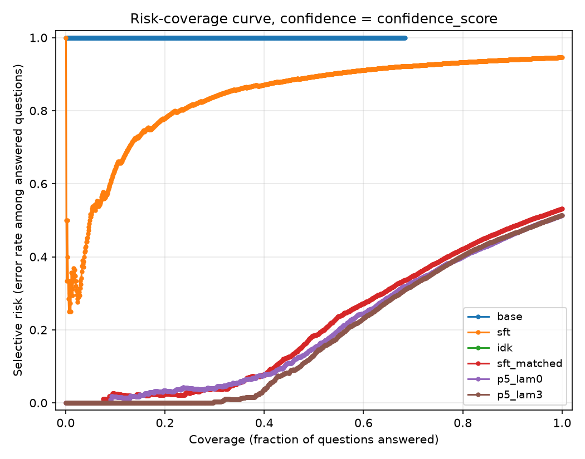
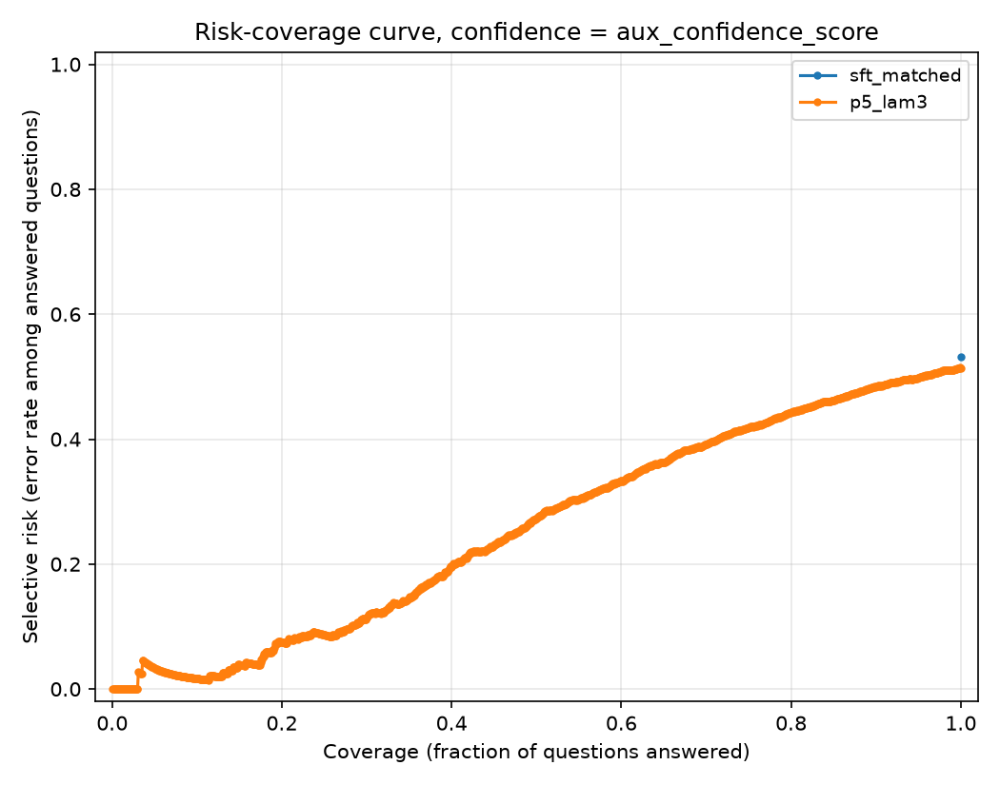

# P6 Week 5 — master table, risk-coverage plot, reproduction manifest

Per `plan.md` §8, Week 5, P6 row: "Run all required methods through the
identical evaluator; bootstrap comparisons; resolve missing/mismatched IDs."
Acceptance: "Master table and risk-coverage plot; reproduction manifest links
every number to a run."

**Scope note up front:** this covers the synthetic track (`main_v0`) only —
the only track with a complete, non-blocked result set across the team right
now. The real-QA track is still blocked on the model/dataset decision (P2's
pilot, `reports/model_dataset_decision.md`), so it has no "required methods"
to run yet. P1's robustness work (second synthetic world, seed repeats) and
P4's calibration-reliability work exist on unmerged branches
(`p1/exposure-analysis`, `feat/p4-calibration-reliability`) as of this
writing — not included here since they aren't on `main` yet; P6 does not
merge or finish other members' branches.

## 1. Master table (main_v0, 1,200 questions, all methods on identical questions)

| Method | Accuracy | Hallucination | Abstention | Coverage | AURC (log-prob) |
|---|---:|---:|---:|---:|---:|
| base (untouched) | 0.0% | 68.3% | 31.7% | 68.3% | 0.683 |
| sft (P6 original recipe) | 5.4% | 94.6% | 0.0% | 100% | 0.838 |
| idk (P6 original recipe) | 0.0% | 0.0% | 100% | 0.0% | n/a |
| **sft_matched** (matched recipe, P6 runner) | **46.8%** | 53.2% | 0.0% | 100% | 0.213 |
| **p5_lam0** (matched recipe, P5 runner) | **48.7%** | 51.3% | 0.0% | 100% | 0.200 |
| **p5_lam3** (evidence-aware, P5's proposed method) | **48.6%** | 51.4% | 0.0% | 100% | 0.185 |

Paired accuracy diffs vs. `sft_matched` (question-cluster bootstrap, 95% CI, n_boot=1000):

| Comparison | Estimate | 95% CI |
|---|---:|---|
| p5_lam0 vs sft_matched | +1.8pp | [0.0, +3.8] |
| p5_lam3 vs sft_matched | +1.8pp | [-0.2, +3.6] |
| sft vs sft_matched | -41.4pp | [-44.2, -38.4] |
| idk vs sft_matched | -46.8pp | [-49.4, -44.0] |

**Which is "the" standard-SFT reference?** `sft_matched`, not the original
`sft`. The original recipe (r=8, q_proj+v_proj only, batch 1) was found during
Week 4 to be too capacity-limited to be a meaningful comparison point (P1's
ablation: target-module choice alone explains ~30 points of the gap). That
recipe change was made during Week 3/4, before any final-test numbers existed
to react to -- consistent with Week 5's "no hyperparameter changes based on
final-test outcomes" rule. The original `sft`/`idk` rows are kept in the table
for history/traceability, not as the headline comparison.

**IDK caveat:** the `idk` row is a known degenerate result (100% abstention --
P1's ablation traced this to a training-order artifact: the 30 IDK examples
are appended after all fact rows with no shuffling, so the final gradient
steps are all refusals). Not re-run with the matched recipe for Week 5 --
that would be introducing new training, which this week's rule says not to
do. Documented here rather than silently included as if it were a real
abstention baseline.

## 2. Risk-coverage plot

`sft_matched`, `p5_lam0`, and `p5_lam3` sit on nearly the same curve, well
below `base` and the original `sft`/`idk` -- visually confirms what the AURC
column says: the matched-recipe methods are close to each other and clearly
better than the under-capacity original recipe, with no visible separation
between plain SFT and the evidence-aware method under log-probability
confidence.

Second plot, auxiliary-head confidence (only `p5_lam3` actually has this
signal -- `sft_matched` has no head, so it collapses to a single point at full
coverage, which is the correct, honest way to show "no signal available" for
that method):

Generated by `p6_baselines/plot_risk_coverage.py`, which calls the exact same
`risk_coverage_curve` function the AURC numbers above come from -- the plot
and the numbers cannot silently disagree.

## 3. Reproduction manifest

Every number above traces to one of these runs. All used the pinned model
`Qwen/Qwen2.5-0.5B-Instruct` @ `7ae557604adf67be50417f59c2c2f167def9a775`,
decoding config `decoding_v1` (`configs/decoding.yaml`: 1 greedy + 5 sampled,
T=0.7, top-p=0.9, top_k=0, repetition_penalty=1.0, 64 max new tokens),
grading `placeholder_exact_v1` (`common/evaluate.py`) -- **not P2's grader,
every number below is provisional pending that**.

| Method | Command | Recipe | Seed | Cluster job | Output file | Commit |
|---|---|---|---|---|---|---|
| base | `run_canonical_baselines.py --dataset-version main_v0` | n/a (untouched) | 0 | 44818 | `results/raw/p1_main_v0_base.jsonl` | `d9b4915` |
| sft | same run | r=8, q_proj+v_proj, batch 1, lr 2e-4, 1 epoch | 0 | 44818 | `results/raw/p1_main_v0_sft.jsonl` | `d9b4915` |
| idk | same run | sft recipe + 30 unshuffled IDK examples | 0 | 44818 | `results/raw/p1_main_v0_idk.jsonl` | `d9b4915` |
| sft_matched | `run_matched_sft.py --dataset-version main_v0` | r=16, alpha=32, dropout=0.05, batch=4, all 7 linear layers, lr 2e-4, 1 epoch (Aryaman/P1's recipe) | 0 | 44204 | `results/raw/p1_main_v0_sft_matched.jsonl` | `9c26dc7` |
| p5_lam0 | P5's `export_responses.py`, lambda=0 | same as sft_matched, float32, P5's seeding order | 0 | P5's own job (see `reports/p5_evidence_aware_training.md` §7) | `results/raw/p5_main_v0_lam0_seed0.jsonl` | merged via PR #8, `45d0dad` |
| p5_lam3 | P5's `export_responses.py`, lambda=3 | same + auxiliary head, `L = L_answer + 3*L_aux` | 0 | P5's own job | `results/raw/p5_main_v0_lam3_seed0.jsonl` | merged via PR #8, `45d0dad` |

**Dataset:** `data/synthetic/main_v0` (600 facts, 3,800 train presentations,
1,200 eval questions, 30 IDK examples), generated by running P1's own,
already-tested generator (`python -m p1_exposure.generate --n-facts 600
--version main_v0`); all 11 of P1's validation checks pass
(`data/manifests/synthetic_main_v0/audit.json`).

**Evaluator:** `p6_baselines/compare_methods.py`, `eval_script_version =
"p6-eval-v1.1"` (`--confidence-field` added, additive, default-unchanged from
v1). Matched-question-join check passed on all 1,200 `question_id`s across
all 6 methods before any metric was computed -- `results/final/baseline_comparison_main_v0_combined.json`
is the full machine-readable output this table summarizes.

**Known corrections already folded in before this freeze:**
- A grading bug (apostrophe-stripping mismatch) that silently misgraded every
  "I don't know" response as "incorrect" -- fixed, re-graded, documented in
  `reports/p6_week2_4_results.md`.
- `base`/`sft`/`idk` on `main_v0` were regenerated under `decoding_v1` after
  being found stale (`decoding_v0`) -- documented in
  `reports/p6_combined_main_v0_table.md`. This changed `base`'s abstention
  rate from 3.9% to 31.7% (a real correction: the old config's
  `repetition_penalty=1.1` was suppressing "I don't know" tokens, per P1's
  ablation).

## 4. What's NOT in this freeze (missing/pending, not silently assumed done)

- **Real-QA baselines**: blocked on the model/dataset decision.
- **P1's second-world/seed-robustness results**: on `p1/exposure-analysis`,
  not merged.
- **P4's frozen calibrators/matched-coverage analysis**: on
  `feat/p4-calibration-reliability`, not merged, and P4's acceptance
  criterion says this should be "passed to P6" -- nothing has been yet.
- **P3's XAI integration**: no P3 branch exists in this repository as of this
  writing.
- **The frozen-representation-head control** (`plan.md` §7's 5th required
  comparison row): partially covered by P5's own report §3.3 ("probe on the
  plain-SFT model"), not re-verified independently here.
- **Seeds beyond 0** for `p5_lam0`/`p5_lam3` on `main_v0` through this exact
  evaluator (P5's own report has 3-seed results on their internal pipeline,
  §3.1-3.2; only seed 0 has been run through `compare_methods.py`).

## 5. Interpretation (consistent with P5's own report)

The matched-recipe standard-SFT baseline and P5's evidence-aware method are
statistically indistinguishable on accuracy (+1.8pp, CI touches 0) and on
log-probability-based risk-coverage (curves overlap). The evidence-aware
method's own auxiliary signal is a *worse* abstention tool than the model's
plain log-probability (AURC 0.258 vs 0.185). This is a negative result for
the practical hypothesis ("the auxiliary signal improves hallucination
control") and a positive one for the narrower claim ("the auxiliary loss
makes evidence exposure more readable in the hidden state") -- exactly as
P5's own report concludes independently.
