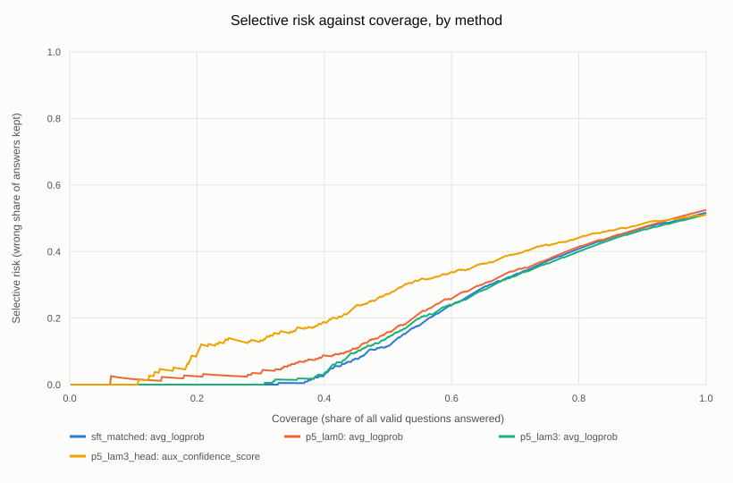

# Method comparison on synthetic main_v0, held-out final split

600 held-out questions from `synthetic-main_v0`; every method answers the same questions. Differences are against `sft_matched`, resampled jointly by `fact_id` (1000 replicates). Each method's policy was fitted and frozen on its own development rows.

## Ranking and calibration

| method | signal | training seed | accuracy, answering everything | AUROC [95% CI] | Brier | ECE | area under risk-coverage | difference [95% CI] |
|---|---|---:|---:|---:|---:|---:|---:|---:|
| sft_matched | `avg_logprob` | 0 | 48.3% | 0.954 [0.933, 0.973] | 0.087 | 0.086 | 0.186 | reference |
| p5_lam0 | `avg_logprob` | 0 | 47.5% | 0.937 [0.910, 0.960] | 0.108 | 0.062 | 0.206 | +0.020 [-0.008, +0.050] |
| p5_lam3 | `avg_logprob` | 0 | 48.8% | 0.944 [0.919, 0.964] | 0.102 | 0.079 | 0.187 | +0.002 [-0.020, +0.025] |
| p5_lam3_head | `aux_confidence_score` | 0 | 48.8% | 0.808 [0.756, 0.853] | 0.179 | 0.074 | 0.261 | +0.075 [+0.041, +0.115] |

Lower is better for Brier, ECE and area under risk-coverage. A difference whose interval includes zero is not evidence that either method is better.

## Frozen and matched coverage

*Frozen* applies the threshold chosen on validation, so achieved coverage can drift from its target. *Matched* sets each method's threshold, without labels, to answer the same share of these questions, and is the fair comparison of selective risk.

| target | method | frozen coverage | frozen selective accuracy | frozen hallucination | confident errors | matched coverage | matched selective risk | difference [95% CI] |
|---:|---|---:|---:|---:|---:|---:|---:|---:|
| 90% | sft_matched | 93.7% | 51.4% | 45.5% | 273 | 90.0% | 47.0% | reference |
| 90% | p5_lam0 | 92.5% | 51.4% | 45.0% | 270 | 90.0% | 47.2% | +0.002 [-0.036, +0.042] |
| 90% | p5_lam3 | 97.2% | 50.3% | 48.3% | 290 | 90.0% | 46.5% | -0.006 [-0.042, +0.029] |
| 90% | p5_lam3_head | 92.7% | 50.9% | 45.5% | 273 | 90.0% | 48.3% | +0.013 [-0.023, +0.048] |
| 80% | sft_matched | 84.2% | 56.4% | 36.7% | 220 | 80.0% | 40.8% | reference |
| 80% | p5_lam0 | 78.7% | 59.5% | 31.8% | 191 | 80.0% | 41.5% | +0.006 [-0.035, +0.048] |
| 80% | p5_lam3 | 90.8% | 53.2% | 42.5% | 255 | 80.0% | 40.0% | -0.008 [-0.048, +0.031] |
| 80% | p5_lam3_head | 86.5% | 53.0% | 40.7% | 244 | 80.0% | 44.2% | +0.033 [-0.009, +0.078] |
| 70% | sft_matched | 68.7% | 68.0% | 22.0% | 132 | 70.0% | 33.1% | reference |
| 70% | p5_lam0 | 68.7% | 66.5% | 23.0% | 138 | 70.0% | 34.3% | +0.012 [-0.034, +0.056] |
| 70% | p5_lam3 | 85.2% | 56.4% | 37.2% | 223 | 70.0% | 32.6% | -0.005 [-0.047, +0.040] |
| 70% | p5_lam3_head | 76.3% | 57.6% | 32.3% | 194 | 70.0% | 39.3% | +0.062 [+0.014, +0.117] |
| 60% | sft_matched | 61.3% | 75.0% | 15.3% | 92 | 60.0% | 23.9% | reference |
| 60% | p5_lam0 | 57.2% | 76.4% | 13.5% | 81 | 60.0% | 25.8% | +0.019 [-0.032, +0.075] |
| 60% | p5_lam3 | 72.8% | 65.2% | 25.3% | 152 | 60.0% | 23.9% | +0.000 [-0.048, +0.053] |
| 60% | p5_lam3_head | 64.2% | 63.9% | 23.2% | 139 | 60.0% | 33.9% | +0.100 [+0.042, +0.161] |
| 50% | sft_matched | 52.0% | 85.6% | 7.5% | 45 | 50.0% | 11.7% | reference |
| 50% | p5_lam0 | 48.7% | 85.6% | 7.0% | 42 | 50.0% | 15.7% | +0.040 [-0.026, +0.093] |
| 50% | p5_lam3 | 57.5% | 78.3% | 12.5% | 75 | 50.0% | 14.3% | +0.027 [-0.031, +0.070] |
| 50% | p5_lam3_head | 52.8% | 69.7% | 16.0% | 96 | 50.0% | 27.3% | +0.157 [+0.085, +0.217] |

