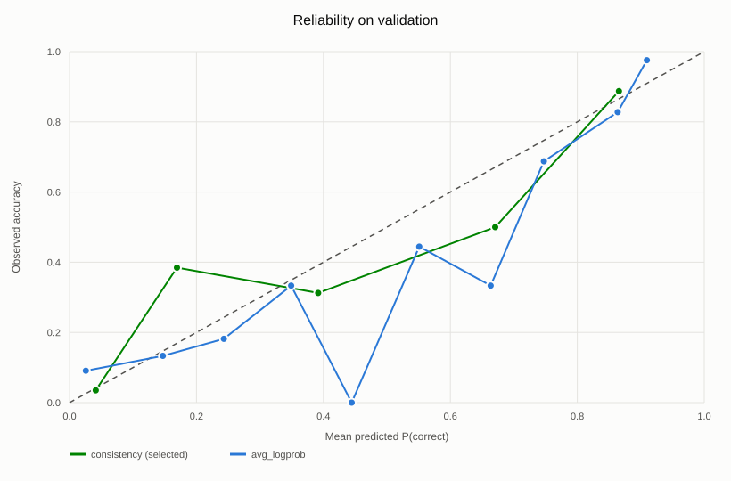
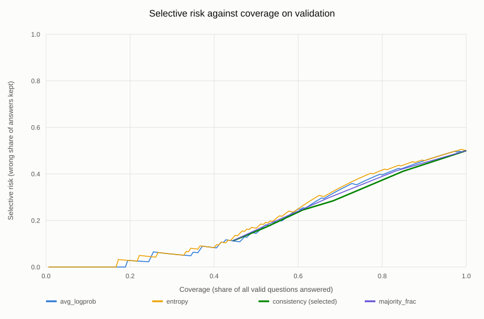

# Confidence calibration: synthetic main_v0, P5 lambda 0, development

Model `Qwen/Qwen2.5-0.5B-Instruct` at `7ae55760`, checkpoint `p5_main_v0_lam0_seed0`; prompt `prompt_v0`, decoding `decoding_v1`, grader `p2_whole_word_v5`. Calibrators are fitted on train only and every choice is made on validation. Signals not available: `sum_logprob`, `min_logprob`, `first_token_entropy`, `aux_confidence_score`.

## Inputs

| file | rows | sha256 | arrived graded with | outcomes changed by regrade |
|---|---:|---|---|---:|
| `results/raw/p5_main_v0_lam0_seed0.jsonl` | 7200 | `3a7f477f9973` | p2_whole_word_v4 | 0 |

## Split counts

Greedy responses, the target being judged.

| split | questions | correct | incorrect | abstain | invalid |
|---|---:|---:|---:|---:|---:|
| train | 420 | 207 | 213 | 0 | 0 |
| validation | 180 | 90 | 90 | 0 | 0 |

## Signal comparison on validation

Attempted greedy answers with a usable signal. Intervals are 95% cluster-bootstrap percentile intervals.
The difference column is AUROC minus `avg_logprob` on the same questions, resampled jointly.

| signal | N (correct/wrong) | AUROC [95% CI] | difference [95% CI] | AUPRC | Brier [95% CI] | base-rate Brier | ECE [95% CI] | ECE read raw |
|---|---:|---:|---:|---:|---:|---:|---:|---:|
| avg_logprob | 180 (90/90) | 0.907 [0.835, 0.963] | reference | 0.922 | 0.124 [0.083, 0.171] | 0.250 | 0.078 [0.064, 0.149] | 0.255 |
| entropy | 180 (90/90) | 0.887 [0.807, 0.949] | -0.020 [-0.041, -0.005] | 0.909 | 0.131 [0.086, 0.184] | 0.250 | 0.076 [0.059, 0.160] | N/A |
| **consistency** | 180 (90/90) | 0.905 [0.841, 0.958] | -0.002 [-0.048, +0.044] | 0.859 | 0.117 [0.073, 0.167] | 0.250 | 0.048 [0.030, 0.115] | 0.122 |
| majority_frac | 180 (90/90) | 0.889 [0.814, 0.948] | -0.018 [-0.066, +0.024] | 0.849 | 0.124 [0.080, 0.171] | 0.250 | 0.037 [0.028, 0.117] | 0.197 |

The selected signal (validation Brier) is in bold. Base-rate Brier predicts the training accuracy (49.3%) for every answer, so a useful signal must beat it. ECE read raw treats the signal itself as a probability (`exp` of a log-probability, or the agreement share); N/A means it has no such reading.

## Abstention policies on validation

Attempted answers below the threshold become abstentions. Rates use all 180 valid questions, abstentions included; selective accuracy uses the answers kept. Thresholds come from validation.

Answering everything: accuracy 50.0%, hallucination 50.0%, abstention 0.0%, coverage 100.0%, selective accuracy 50.0%.

| signal | target coverage | threshold P(correct) | coverage | accuracy | selective accuracy | hallucination | confident errors |
|---|---:|---:|---:|---:|---:|---:|---:|
| consistency | 90% | 0.020 | 100.0% | 50.0% | 50.0% | 50.0% | 90 |
| consistency | 80% | 0.061 | 85.0% | 50.0% | 58.8% | 35.0% | 63 |
| consistency | 70% | 0.061 | 85.0% | 50.0% | 58.8% | 35.0% | 63 |
| consistency | 60% | 0.392 | 61.1% | 46.1% | 75.5% | 15.0% | 27 |
| consistency | 50% | 0.671 | 52.2% | 43.3% | 83.0% | 8.9% | 16 |
| avg_logprob | 90% | 0.008 | 90.0% | 48.9% | 54.3% | 41.1% | 74 |
| avg_logprob | 80% | 0.070 | 80.0% | 48.3% | 60.4% | 31.7% | 57 |
| avg_logprob | 70% | 0.175 | 70.0% | 46.7% | 66.7% | 23.3% | 42 |
| avg_logprob | 60% | 0.378 | 60.0% | 45.0% | 75.0% | 15.0% | 27 |
| avg_logprob | 50% | 0.672 | 50.0% | 42.8% | 85.6% | 7.2% | 13 |

Tied scores can make a threshold keep more answers than its target; the coverage column shows what was actually kept.

## Threshold stability

How much the 80%-coverage threshold moves when validation is resampled.

| signal | threshold | 95% interval |
|---|---:|---:|
| avg_logprob | 0.070 | [0.015, 0.152] |
| entropy | 0.032 | [0.009, 0.132] |
| consistency | 0.061 | [0.020, 0.061] |
| majority_frac | 0.110 | [0.031, 0.110] |

## Signal stability across groups

Descriptive. AUROC is N/A where a group has only one outcome. Sampled K does not include the greedy answer being judged, but it shares its samples with the consistency signals.

| signal | grouping | group | questions | correct/wrong | AUROC [95% CI] | Brier | ECE |
|---|---|---|---:|---:|---:|---:|---:|
| consistency | exposure level | 0 | 30 | 0/30 | N/A [N/A, N/A] | 0.202 | 0.302 |
| consistency | exposure level | 1 | 30 | 3/27 | 0.864 [0.517, 1.000] | 0.109 | 0.152 |
| consistency | exposure level | 2 | 30 | 10/20 | 0.945 [0.800, 1.000] | 0.105 | 0.152 |
| consistency | exposure level | 5 | 30 | 26/4 | 0.952 [0.802, 1.000] | 0.086 | 0.174 |
| consistency | exposure level | 10 | 30 | 25/5 | 0.860 [0.652, 1.000] | 0.087 | 0.113 |
| consistency | exposure level | 20 | 30 | 26/4 | 0.712 [0.423, 1.000] | 0.112 | 0.094 |
| consistency | sample knowledge score | 0<K<0.8 | 20 | 12/8 | 0.594 [0.075, 0.896] | 0.408 | 0.487 |
| consistency | sample knowledge score | K=0 | 82 | 0/82 | N/A [N/A, N/A] | 0.132 | 0.224 |
| consistency | sample knowledge score | K>=0.8 | 78 | 78/0 | N/A [N/A, N/A] | 0.026 | 0.152 |
| avg_logprob | exposure level | 0 | 30 | 0/30 | N/A [N/A, N/A] | 0.188 | 0.322 |
| avg_logprob | exposure level | 1 | 30 | 3/27 | 0.914 [0.621, 1.000] | 0.102 | 0.188 |
| avg_logprob | exposure level | 2 | 30 | 10/20 | 0.670 [0.296, 0.970] | 0.204 | 0.198 |
| avg_logprob | exposure level | 5 | 30 | 26/4 | 0.942 [0.800, 1.000] | 0.070 | 0.180 |
| avg_logprob | exposure level | 10 | 30 | 25/5 | 0.880 [0.697, 1.000] | 0.116 | 0.163 |
| avg_logprob | exposure level | 20 | 30 | 26/4 | 0.875 [0.616, 1.000] | 0.066 | 0.067 |
| avg_logprob | sample knowledge score | 0<K<0.8 | 20 | 12/8 | 0.427 [0.055, 0.750] | 0.384 | 0.361 |
| avg_logprob | sample knowledge score | K=0 | 82 | 0/82 | N/A [N/A, N/A] | 0.130 | 0.237 |
| avg_logprob | sample knowledge score | K>=0.8 | 78 | 78/0 | N/A [N/A, N/A] | 0.052 | 0.164 |

## High-confidence errors on validation

`consistency` at the 80%-coverage threshold (P(correct) >= 0.061): 63 wrong out of 153 answers kept.

| pattern | meaning | count |
|---|---|---:|
| stable_wrong | K=0; the samples repeat the wrong answer | 14 |
| wavering_wrong | K=0; the samples disagree with it | 44 |
| knows_sometimes | K>0; some samples are right | 5 |

Flagged by the shared grader for review: 0. Every error is listed in `confident_errors.csv`.

By exposure level: 0x: 25, 1x: 17, 2x: 9, 5x: 3, 10x: 5, 20x: 4.

Most confident errors:

| P(correct) | pattern | question | answer | reference |
|---:|---|---|---|---|
| 0.866 | stable_wrong | Which person is credited with founding the Hutrar Society? | Shenpugaen Daekuglath | Shunboumoun Gloushizhi |
| 0.866 | stable_wrong | Who set up the Hutrar Society? | Shenpugaen Daekuglath | Shunboumoun Gloushizhi |
| 0.866 | stable_wrong | What city serves as the seat of government of Pantranda? | Naplaenhath | Naplaenheth |
| 0.866 | stable_wrong | Where is the capital of Pantranda? | Naplaenhath | Naplaenheth |
| 0.866 | stable_wrong | Where is the capital of Zutraek? | Boukrindroul | Brouzoki |
| 0.866 | stable_wrong | What kind of work was Dobrenzous Hesenka known for? | tapestry weaver | lens grinder |
| 0.866 | stable_wrong | What trade did Funshenmi Lunthunim practise? | tapestry weaver | herbalist |
| 0.866 | stable_wrong | What kind of work was Fethos Zinplim known for? | tapestry weaver | bell founder |
| 0.866 | stable_wrong | What trade did Fethos Zinplim practise? | tapestry weaver | bell founder |
| 0.671 | knows_sometimes | What city serves as the seat of government of Zutraek? | Boukrindroul | Brouzoki |
| 0.671 | stable_wrong | Which city hosts the head office of the Fethaer Institute? | Guglath | Driraglith |
| 0.671 | stable_wrong | What kind of work was Tanges Dumisik known for? | tapestry weaver | astronomer |
| 0.671 | stable_wrong | What trade did Tanges Dumisik practise? | harpsichord maker | astronomer |
| 0.671 | stable_wrong | What trade did Dobrenzous Hesenka practise? | tapestry weaver | lens grinder |
| 0.671 | knows_sometimes | What kind of work was Tokouk Souluth known for? | tapestry weaver | orchardist |

Reliability bins holding few answers are noisy; their counts are in the JSON results.

