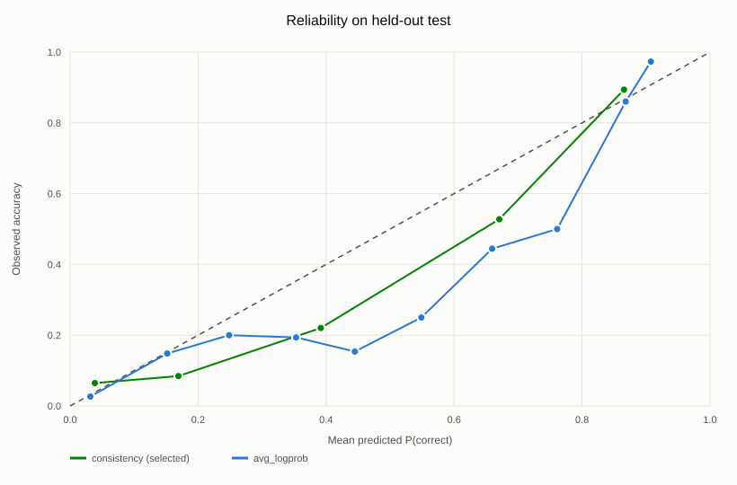
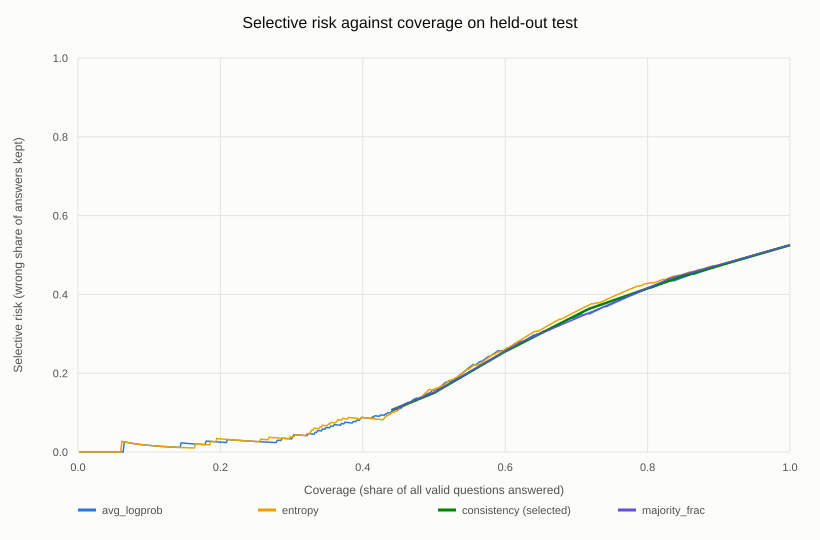

# Confidence calibration: synthetic main_v0, P5 lambda 0, held-out final split

Model `Qwen/Qwen2.5-0.5B-Instruct` at `7ae55760`, checkpoint `p5_main_v0_lam0_seed0`; prompt `prompt_v0`, decoding `decoding_v1`, grader `p2_whole_word_v5`. Calibrators are fitted on train only and every choice is made on validation. Signals not available: `sum_logprob`, `min_logprob`, `first_token_entropy`, `aux_confidence_score`.

Frozen policy `f914fea5322f`, fitted on `p5_main_v0_lam0_seed0` / `synthetic-main_v0`, applied unchanged. Nothing was refitted or reselected.

## Inputs

| file | rows | sha256 | arrived graded with | outcomes changed by regrade |
|---|---:|---|---|---:|
| `results/raw/p5_main_v0_lam0_seed0.jsonl` | 7200 | `3a7f477f9973` | p2_whole_word_v4 | 0 |

## Split counts

Greedy responses, the target being judged.

| split | questions | correct | incorrect | abstain | invalid |
|---|---:|---:|---:|---:|---:|
| held-out test | 600 | 285 | 315 | 0 | 0 |

## Signal comparison on held-out test

Attempted greedy answers with a usable signal. Intervals are 95% cluster-bootstrap percentile intervals.
The difference column is AUROC minus `avg_logprob` on the same questions, resampled jointly.

| signal | N (correct/wrong) | AUROC [95% CI] | difference [95% CI] | AUPRC | Brier [95% CI] | base-rate Brier | ECE [95% CI] | ECE read raw |
|---|---:|---:|---:|---:|---:|---:|---:|---:|
| avg_logprob | 600 (285/315) | 0.937 [0.910, 0.960] | reference | 0.935 | 0.108 [0.085, 0.131] | 0.250 | 0.062 [0.050, 0.103] | 0.282 |
| entropy | 600 (285/315) | 0.927 [0.894, 0.953] | -0.011 [-0.024, +0.000] | 0.929 | 0.112 [0.091, 0.137] | 0.250 | 0.095 [0.074, 0.132] | N/A |
| **consistency** | 600 (285/315) | 0.911 [0.882, 0.941] | -0.026 [-0.046, -0.006] | 0.865 | 0.105 [0.084, 0.126] | 0.250 | 0.055 [0.031, 0.087] | 0.155 |
| majority_frac | 600 (285/315) | 0.908 [0.875, 0.937] | -0.030 [-0.051, -0.009] | 0.862 | 0.104 [0.083, 0.126] | 0.250 | 0.043 [0.023, 0.075] | 0.204 |

The selected signal (validation Brier) is in bold. Base-rate Brier predicts the training accuracy (49.3%) for every answer, so a useful signal must beat it. ECE read raw treats the signal itself as a probability (`exp` of a log-probability, or the agreement share); N/A means it has no such reading.

## Abstention policies on held-out test

Attempted answers below the threshold become abstentions. Rates use all 600 valid questions, abstentions included; selective accuracy uses the answers kept. Thresholds come from validation.

Answering everything: accuracy 47.5%, hallucination 52.5%, abstention 0.0%, coverage 100.0%, selective accuracy 47.5%.

| signal | target coverage | threshold P(correct) | coverage | accuracy | selective accuracy | hallucination | confident errors |
|---|---:|---:|---:|---:|---:|---:|---:|
| consistency | 90% | 0.020 | 100.0% | 47.5% | 47.5% | 52.5% | 315 |
| consistency | 80% | 0.061 | 84.7% | 47.0% | 55.5% | 37.7% | 226 |
| consistency | 70% | 0.061 | 84.7% | 47.0% | 55.5% | 37.7% | 226 |
| consistency | 60% | 0.392 | 59.8% | 44.7% | 74.7% | 15.2% | 91 |
| consistency | 50% | 0.671 | 50.0% | 42.5% | 85.0% | 7.5% | 45 |
| avg_logprob | 90% | 0.008 | 92.5% | 47.5% | 51.4% | 45.0% | 270 |
| avg_logprob | 80% | 0.070 | 78.7% | 46.8% | 59.5% | 31.8% | 191 |
| avg_logprob | 70% | 0.175 | 68.7% | 45.7% | 66.5% | 23.0% | 138 |
| avg_logprob | 60% | 0.378 | 57.2% | 43.7% | 76.4% | 13.5% | 81 |
| avg_logprob | 50% | 0.672 | 48.7% | 41.7% | 85.6% | 7.0% | 42 |

Tied scores can make a threshold keep more answers than its target; the coverage column shows what was actually kept.

## Signal stability across groups

Descriptive. AUROC is N/A where a group has only one outcome. Sampled K does not include the greedy answer being judged, but it shares its samples with the consistency signals.

| signal | grouping | group | questions | correct/wrong | AUROC [95% CI] | Brier | ECE |
|---|---|---|---:|---:|---:|---:|---:|
| consistency | exposure level | 0 | 100 | 0/100 | N/A [N/A, N/A] | 0.140 | 0.256 |
| consistency | exposure level | 1 | 100 | 7/93 | 0.879 [0.679, 0.975] | 0.109 | 0.155 |
| consistency | exposure level | 2 | 100 | 25/75 | 0.887 [0.778, 0.976] | 0.107 | 0.077 |
| consistency | exposure level | 5 | 100 | 68/32 | 0.877 [0.784, 0.952] | 0.147 | 0.154 |
| consistency | exposure level | 10 | 100 | 89/11 | 0.779 [0.536, 0.991] | 0.089 | 0.133 |
| consistency | exposure level | 20 | 100 | 96/4 | 0.740 [0.463, 1.000] | 0.039 | 0.125 |
| consistency | sample knowledge score | 0<K<0.8 | 56 | 27/29 | 0.667 [0.503, 0.822] | 0.313 | 0.278 |
| consistency | sample knowledge score | K=0 | 288 | 3/285 | 0.142 [0.114, 0.171] | 0.136 | 0.218 |
| consistency | sample knowledge score | K>=0.8 | 256 | 255/1 | 1.000 [1.000, 1.000] | 0.025 | 0.149 |
| avg_logprob | exposure level | 0 | 100 | 0/100 | N/A [N/A, N/A] | 0.172 | 0.297 |
| avg_logprob | exposure level | 1 | 100 | 7/93 | 0.782 [0.556, 0.959] | 0.108 | 0.134 |
| avg_logprob | exposure level | 2 | 100 | 25/75 | 0.854 [0.712, 0.964] | 0.140 | 0.094 |
| avg_logprob | exposure level | 5 | 100 | 68/32 | 0.914 [0.827, 0.976] | 0.133 | 0.118 |
| avg_logprob | exposure level | 10 | 100 | 89/11 | 0.891 [0.744, 1.000] | 0.066 | 0.113 |
| avg_logprob | exposure level | 20 | 100 | 96/4 | 0.958 [0.865, 1.000] | 0.028 | 0.091 |
| avg_logprob | sample knowledge score | 0<K<0.8 | 56 | 27/29 | 0.667 [0.498, 0.831] | 0.287 | 0.248 |
| avg_logprob | sample knowledge score | K=0 | 288 | 3/285 | 0.642 [0.517, 0.751] | 0.140 | 0.233 |
| avg_logprob | sample knowledge score | K>=0.8 | 256 | 255/1 | 0.945 [0.911, 0.973] | 0.033 | 0.137 |

## High-confidence errors on held-out test

`consistency` at the 80%-coverage threshold (P(correct) >= 0.061): 226 wrong out of 508 answers kept.

| pattern | meaning | count |
|---|---|---:|
| stable_wrong | K=0; the samples repeat the wrong answer | 45 |
| wavering_wrong | K=0; the samples disagree with it | 159 |
| knows_sometimes | K>0; some samples are right | 22 |

Flagged by the shared grader for review: 5. Every error is listed in `confident_errors.csv`.

By exposure level: 0x: 77, 1x: 61, 2x: 51, 5x: 24, 10x: 9, 20x: 4.

Most confident errors:

| P(correct) | pattern | question | answer | reference |
|---:|---|---|---|---|
| 0.866 | stable_wrong | What year did Brebreglath Trobroubre come into the world? | 1822 | 1861 |
| 0.866 | stable_wrong | The Plaekous Foundry owes its founding to which person? | Tenglo Zhuvlakrou | Zaglael Zaebaeduk |
| 0.866 | stable_wrong | Which city does Hondezan govern from? | Sikrishou | Plaezhounpen |
| 0.866 | stable_wrong | What is the name of Zulifil's capital? | Boukrindroul | Vevlinmoth |
| 0.866 | stable_wrong | Which city does Glisinuk govern from? | Kenplunath | Kenpluneth |
| 0.866 | stable_wrong | What is the name of Glisinuk's capital? | Kenplunath | Kenpluneth |
| 0.866 | stable_wrong | The Baehath Guild operates out of which city? | Haeglonvi | Haeglonbru |
| 0.866 | stable_wrong | Where is the main base of the Baehath Guild? | Haeglonvi | Haeglonbru |
| 0.866 | stable_wrong | The Haeshuple Foundry operates out of which city? | Boukrindroul | Bouvenhos |
| 0.866 | stable_wrong | Where is the main base of the Haeshuple Foundry? | Boukrindroul | Bouvenhos |
| 0.866 | stable_wrong | How did Saensaekraes Briroum earn a living? | tapestry weaver | cobbler |
| 0.866 | stable_wrong | Which line of work was Saensaekraes Briroum in? | tapestry weaver | cobbler |
| 0.866 | stable_wrong | How did Motraen Mabrondo earn a living? | ferryman | falconer |
| 0.866 | stable_wrong | Which line of work was Motraen Mabrondo in? | ferryman | falconer |
| 0.866 | stable_wrong | How did Daevisan Shoplonkrol earn a living? | tapestry weaver | lighthouse keeper |

Reliability bins holding few answers are noisy; their counts are in the JSON results.

