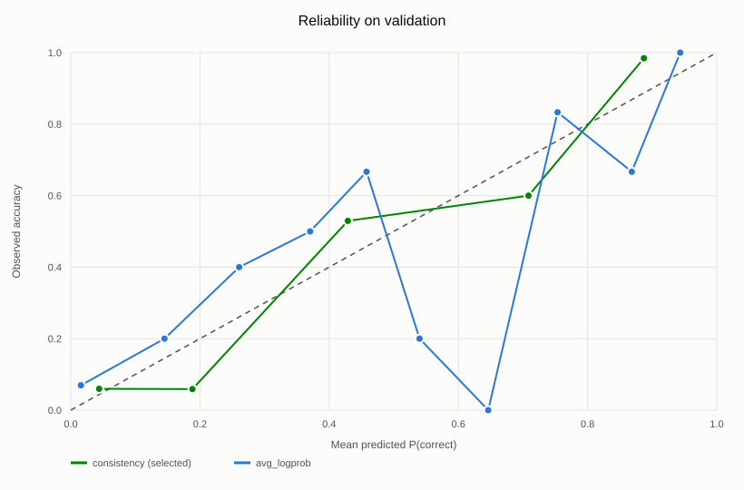
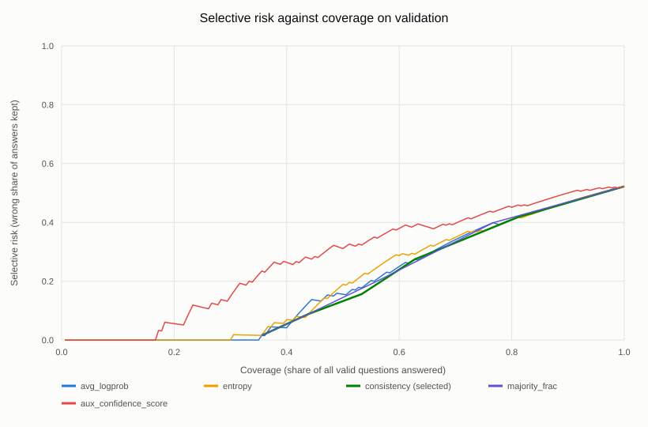

# Confidence calibration: synthetic main_v0, P5 lambda 3, development

Model `Qwen/Qwen2.5-0.5B-Instruct` at `7ae55760`, checkpoint `p5_main_v0_lam3_seed0`; prompt `prompt_v0`, decoding `decoding_v1`, grader `p2_whole_word_v5`. Calibrators are fitted on train only and every choice is made on validation. Signals not available: `sum_logprob`, `min_logprob`, `first_token_entropy`.

## Inputs

| file | rows | sha256 | arrived graded with | outcomes changed by regrade |
|---|---:|---|---|---:|
| `results/raw/p5_main_v0_lam3_seed0.jsonl` | 7200 | `fdcf298262d3` | p2_whole_word_v4 | 0 |

## Split counts

Greedy responses, the target being judged.

| split | questions | correct | incorrect | abstain | invalid |
|---|---:|---:|---:|---:|---:|
| train | 420 | 204 | 216 | 0 | 0 |
| validation | 180 | 86 | 94 | 0 | 0 |

## Signal comparison on validation

Attempted greedy answers with a usable signal. Intervals are 95% cluster-bootstrap percentile intervals.
The difference column is AUROC minus `avg_logprob` on the same questions, resampled jointly.

| signal | N (correct/wrong) | AUROC [95% CI] | difference [95% CI] | AUPRC | Brier [95% CI] | base-rate Brier | ECE [95% CI] | ECE read raw |
|---|---:|---:|---:|---:|---:|---:|---:|---:|
| avg_logprob | 180 (86/94) | 0.947 [0.908, 0.980] | reference | 0.954 | 0.092 [0.056, 0.128] | 0.250 | 0.091 [0.063, 0.146] | 0.231 |
| entropy | 180 (86/94) | 0.934 [0.885, 0.973] | -0.013 [-0.039, +0.006] | 0.944 | 0.100 [0.060, 0.143] | 0.250 | 0.097 [0.069, 0.153] | N/A |
| **consistency** | 180 (86/94) | 0.950 [0.908, 0.982] | +0.003 [-0.024, +0.031] | 0.939 | 0.082 [0.053, 0.115] | 0.250 | 0.071 [0.050, 0.119] | 0.087 |
| majority_frac | 180 (86/94) | 0.939 [0.888, 0.979] | -0.008 [-0.046, +0.030] | 0.930 | 0.086 [0.055, 0.123] | 0.250 | 0.051 [0.036, 0.107] | 0.148 |
| aux_confidence_score | 180 (86/94) | 0.789 [0.698, 0.870] | -0.158 [-0.234, -0.091] | 0.820 | 0.190 [0.145, 0.239] | 0.250 | 0.102 [0.085, 0.206] | 0.232 |

The selected signal (validation Brier) is in bold. Base-rate Brier predicts the training accuracy (48.6%) for every answer, so a useful signal must beat it. ECE read raw treats the signal itself as a probability (`exp` of a log-probability, or the agreement share); N/A means it has no such reading.

## Abstention policies on validation

Attempted answers below the threshold become abstentions. Rates use all 180 valid questions, abstentions included; selective accuracy uses the answers kept. Thresholds come from validation.

Answering everything: accuracy 47.8%, hallucination 52.2%, abstention 0.0%, coverage 100.0%, selective accuracy 47.8%.

| signal | target coverage | threshold P(correct) | coverage | accuracy | selective accuracy | hallucination | confident errors |
|---|---:|---:|---:|---:|---:|---:|---:|
| consistency | 90% | 0.022 | 100.0% | 47.8% | 47.8% | 52.2% | 94 |
| consistency | 80% | 0.067 | 81.1% | 47.2% | 58.2% | 33.9% | 61 |
| consistency | 70% | 0.067 | 81.1% | 47.2% | 58.2% | 33.9% | 61 |
| consistency | 60% | 0.188 | 62.8% | 45.6% | 72.6% | 17.2% | 31 |
| consistency | 50% | 0.429 | 53.3% | 45.0% | 84.4% | 8.3% | 15 |
| avg_logprob | 90% | 0.000 | 90.0% | 47.8% | 53.1% | 42.2% | 76 |
| avg_logprob | 80% | 0.006 | 80.0% | 47.2% | 59.0% | 32.8% | 59 |
| avg_logprob | 70% | 0.021 | 70.0% | 46.1% | 65.9% | 23.9% | 43 |
| avg_logprob | 60% | 0.101 | 60.0% | 45.0% | 75.0% | 15.0% | 27 |
| avg_logprob | 50% | 0.382 | 50.0% | 42.2% | 84.4% | 7.8% | 14 |

Tied scores can make a threshold keep more answers than its target; the coverage column shows what was actually kept.

## Threshold stability

How much the 80%-coverage threshold moves when validation is resampled.

| signal | threshold | 95% interval |
|---|---:|---:|
| avg_logprob | 0.006 | [0.001, 0.015] |
| entropy | 0.003 | [0.001, 0.013] |
| consistency | 0.067 | [0.022, 0.067] |
| majority_frac | 0.021 | [0.021, 0.090] |
| aux_confidence_score | 0.150 | [0.116, 0.209] |

## Signal stability across groups

Descriptive. AUROC is N/A where a group has only one outcome. Sampled K does not include the greedy answer being judged, but it shares its samples with the consistency signals.

| signal | grouping | group | questions | correct/wrong | AUROC [95% CI] | Brier | ECE |
|---|---|---|---:|---:|---:|---:|---:|
| consistency | exposure level | 0 | 30 | 0/30 | N/A [N/A, N/A] | 0.127 | 0.247 |
| consistency | exposure level | 1 | 30 | 4/26 | 0.779 [0.594, 0.983] | 0.084 | 0.068 |
| consistency | exposure level | 2 | 30 | 5/25 | 0.932 [0.626, 1.000] | 0.052 | 0.039 |
| consistency | exposure level | 5 | 30 | 23/7 | 0.957 [0.846, 1.000] | 0.111 | 0.189 |
| consistency | exposure level | 10 | 30 | 24/6 | 0.875 [0.710, 1.000] | 0.100 | 0.113 |
| consistency | exposure level | 20 | 30 | 30/0 | N/A [N/A, N/A] | 0.015 | 0.119 |
| consistency | sample knowledge score | 0<K<0.8 | 23 | 13/10 | 0.800 [0.604, 0.964] | 0.287 | 0.324 |
| consistency | sample knowledge score | K=0 | 85 | 1/84 | 0.185 [0.116, 0.247] | 0.077 | 0.141 |
| consistency | sample knowledge score | K>=0.8 | 72 | 72/0 | N/A [N/A, N/A] | 0.022 | 0.135 |
| avg_logprob | exposure level | 0 | 30 | 0/30 | N/A [N/A, N/A] | 0.094 | 0.181 |
| avg_logprob | exposure level | 1 | 30 | 4/26 | 0.683 [0.407, 0.931] | 0.130 | 0.127 |
| avg_logprob | exposure level | 2 | 30 | 5/25 | 0.920 [0.621, 1.000] | 0.065 | 0.094 |
| avg_logprob | exposure level | 5 | 30 | 23/7 | 0.826 [0.580, 1.000] | 0.180 | 0.237 |
| avg_logprob | exposure level | 10 | 30 | 24/6 | 0.944 [0.864, 1.000] | 0.081 | 0.145 |
| avg_logprob | exposure level | 20 | 30 | 30/0 | N/A [N/A, N/A] | 0.004 | 0.058 |
| avg_logprob | sample knowledge score | 0<K<0.8 | 23 | 13/10 | 0.823 [0.579, 0.985] | 0.263 | 0.347 |
| avg_logprob | sample knowledge score | K=0 | 85 | 1/84 | 0.333 [0.217, 0.464] | 0.080 | 0.126 |
| avg_logprob | sample knowledge score | K>=0.8 | 72 | 72/0 | N/A [N/A, N/A] | 0.053 | 0.125 |

## High-confidence errors on validation

`consistency` at the 80%-coverage threshold (P(correct) >= 0.067): 61 wrong out of 146 answers kept.

| pattern | meaning | count |
|---|---|---:|
| stable_wrong | K=0; the samples repeat the wrong answer | 7 |
| wavering_wrong | K=0; the samples disagree with it | 46 |
| knows_sometimes | K>0; some samples are right | 8 |

Flagged by the shared grader for review: 2. Every error is listed in `confident_errors.csv`.

By exposure level: 0x: 24, 1x: 14, 2x: 12, 5x: 5, 10x: 6.

Most confident errors:

| P(correct) | pattern | question | answer | reference |
|---:|---|---|---|---|
| 0.887 | stable_wrong | Can you tell me the year Zunluzaes Naglar was born? | 1902 | 1978 |
| 0.709 | stable_wrong | When was Broupun Brenno born? Give the year. | 1952 | 1836 |
| 0.709 | stable_wrong | Which person is credited with founding the Hutrar Society? | Shindaglath Poudroumi | Shunboumoun Gloushizhi |
| 0.709 | stable_wrong | Which city hosts the head office of the Fethaer Institute? | Vantheth | Driraglith |
| 0.709 | stable_wrong | What kind of work was Dobrenzous Hesenka known for? | falconer | lens grinder |
| 0.709 | stable_wrong | What kind of work was Fethos Zinplim known for? | tapestry weaver | bell founder |
| 0.709 | stable_wrong | What trade did Fethos Zinplim practise? | tapestry weaver | bell founder |
| 0.429 | knows_sometimes | When was Zunluzaes Naglar born? Give the year. | 1902 | 1978 |
| 0.429 | wavering_wrong | Can you tell me the year Zhomintel Vlondolael was born? | 1958 | 1935 |
| 0.429 | wavering_wrong | Can you tell me the year Broupun Brenno was born? | 1952 | 1836 |
| 0.429 | wavering_wrong | What city serves as the seat of government of Fungaenbik? | Vlouvlitrouth | Vabaer |
| 0.429 | wavering_wrong | What is the home city of the Fethaer Institute? | Vantheth | Driraglith |
| 0.429 | knows_sometimes | What trade did Vaedoude Zekrunglom practise? | glassblower | fletcher |
| 0.429 | wavering_wrong | What trade did Dobrenzous Hesenka practise? | glassblower | lens grinder |
| 0.429 | wavering_wrong | What trade did Funshenmi Lunthunim practise? | cooper | herbalist |

Reliability bins holding few answers are noisy; their counts are in the JSON results.

