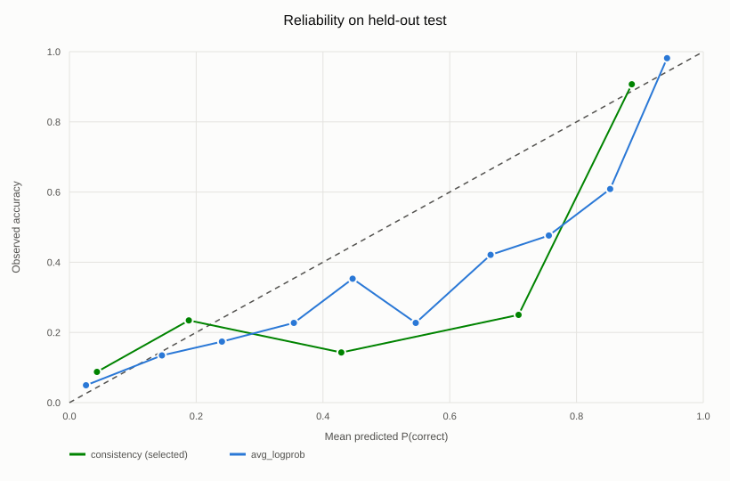
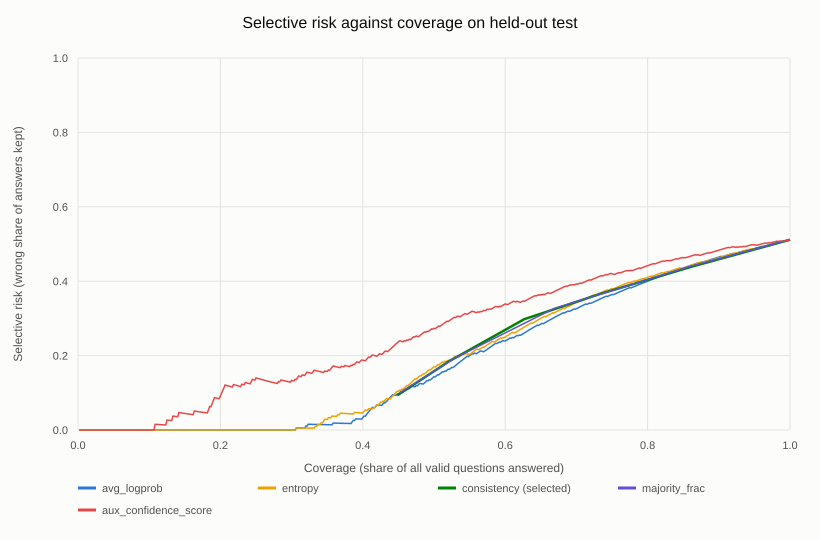

# Confidence calibration: synthetic main_v0, P5 lambda 3, held-out final split

Model `Qwen/Qwen2.5-0.5B-Instruct` at `7ae55760`, checkpoint `p5_main_v0_lam3_seed0`; prompt `prompt_v0`, decoding `decoding_v1`, grader `p2_whole_word_v5`. Calibrators are fitted on train only and every choice is made on validation. Signals not available: `sum_logprob`, `min_logprob`, `first_token_entropy`.

Frozen policy `f48e5a95945b`, fitted on `p5_main_v0_lam3_seed0` / `synthetic-main_v0`, applied unchanged. Nothing was refitted or reselected.

## Inputs

| file | rows | sha256 | arrived graded with | outcomes changed by regrade |
|---|---:|---|---|---:|
| `results/raw/p5_main_v0_lam3_seed0.jsonl` | 7200 | `fdcf298262d3` | p2_whole_word_v4 | 0 |

## Split counts

Greedy responses, the target being judged.

| split | questions | correct | incorrect | abstain | invalid |
|---|---:|---:|---:|---:|---:|
| held-out test | 600 | 293 | 307 | 0 | 0 |

## Signal comparison on held-out test

Attempted greedy answers with a usable signal. Intervals are 95% cluster-bootstrap percentile intervals.
The difference column is AUROC minus `avg_logprob` on the same questions, resampled jointly.

| signal | N (correct/wrong) | AUROC [95% CI] | difference [95% CI] | AUPRC | Brier [95% CI] | base-rate Brier | ECE [95% CI] | ECE read raw |
|---|---:|---:|---:|---:|---:|---:|---:|---:|
| avg_logprob | 600 (293/307) | 0.944 [0.919, 0.964] | reference | 0.955 | 0.102 [0.081, 0.126] | 0.250 | 0.079 [0.058, 0.112] | 0.272 |
| entropy | 600 (293/307) | 0.928 [0.898, 0.953] | -0.016 [-0.029, -0.004] | 0.944 | 0.105 [0.083, 0.129] | 0.250 | 0.079 [0.059, 0.114] | N/A |
| **consistency** | 600 (293/307) | 0.897 [0.863, 0.927] | -0.047 [-0.071, -0.022] | 0.866 | 0.129 [0.105, 0.154] | 0.250 | 0.089 [0.065, 0.119] | 0.160 |
| majority_frac | 600 (293/307) | 0.893 [0.858, 0.922] | -0.051 [-0.076, -0.027] | 0.858 | 0.124 [0.101, 0.151] | 0.250 | 0.069 [0.048, 0.106] | 0.213 |
| aux_confidence_score | 600 (293/307) | 0.808 [0.756, 0.853] | -0.136 [-0.184, -0.097] | 0.833 | 0.179 [0.156, 0.206] | 0.250 | 0.074 [0.054, 0.124] | 0.248 |

The selected signal (validation Brier) is in bold. Base-rate Brier predicts the training accuracy (48.6%) for every answer, so a useful signal must beat it. ECE read raw treats the signal itself as a probability (`exp` of a log-probability, or the agreement share); N/A means it has no such reading.

## Abstention policies on held-out test

Attempted answers below the threshold become abstentions. Rates use all 600 valid questions, abstentions included; selective accuracy uses the answers kept. Thresholds come from validation.

Answering everything: accuracy 48.8%, hallucination 51.2%, abstention 0.0%, coverage 100.0%, selective accuracy 48.8%.

| signal | target coverage | threshold P(correct) | coverage | accuracy | selective accuracy | hallucination | confident errors |
|---|---:|---:|---:|---:|---:|---:|---:|
| consistency | 90% | 0.022 | 100.0% | 48.8% | 48.8% | 51.2% | 307 |
| consistency | 80% | 0.067 | 86.2% | 48.3% | 56.1% | 37.8% | 227 |
| consistency | 70% | 0.067 | 86.2% | 48.3% | 56.1% | 37.8% | 227 |
| consistency | 60% | 0.188 | 73.3% | 46.5% | 63.4% | 26.8% | 161 |
| consistency | 50% | 0.429 | 62.7% | 44.0% | 70.2% | 18.7% | 112 |
| avg_logprob | 90% | 0.000 | 97.2% | 48.8% | 50.3% | 48.3% | 290 |
| avg_logprob | 80% | 0.006 | 90.8% | 48.3% | 53.2% | 42.5% | 255 |
| avg_logprob | 70% | 0.021 | 85.2% | 48.0% | 56.4% | 37.2% | 223 |
| avg_logprob | 60% | 0.101 | 72.8% | 47.5% | 65.2% | 25.3% | 152 |
| avg_logprob | 50% | 0.382 | 57.5% | 45.0% | 78.3% | 12.5% | 75 |

Tied scores can make a threshold keep more answers than its target; the coverage column shows what was actually kept.

## Signal stability across groups

Descriptive. AUROC is N/A where a group has only one outcome. Sampled K does not include the greedy answer being judged, but it shares its samples with the consistency signals.

| signal | grouping | group | questions | correct/wrong | AUROC [95% CI] | Brier | ECE |
|---|---|---|---:|---:|---:|---:|---:|
| consistency | exposure level | 0 | 100 | 2/98 | 0.283 [0.040, 0.593] | 0.204 | 0.295 |
| consistency | exposure level | 1 | 100 | 7/93 | 0.692 [0.413, 0.887] | 0.158 | 0.194 |
| consistency | exposure level | 2 | 100 | 26/74 | 0.840 [0.719, 0.938] | 0.146 | 0.099 |
| consistency | exposure level | 5 | 100 | 71/29 | 0.868 [0.758, 0.952] | 0.163 | 0.163 |
| consistency | exposure level | 10 | 100 | 93/7 | 0.812 [0.469, 0.988] | 0.073 | 0.124 |
| consistency | exposure level | 20 | 100 | 94/6 | 0.917 [0.750, 1.000] | 0.032 | 0.118 |
| consistency | sample knowledge score | 0<K<0.8 | 53 | 35/18 | 0.706 [0.526, 0.860] | 0.439 | 0.499 |
| consistency | sample knowledge score | K=0 | 292 | 3/289 | 0.128 [0.098, 0.159] | 0.172 | 0.269 |
| consistency | sample knowledge score | K>=0.8 | 255 | 255/0 | N/A [N/A, N/A] | 0.016 | 0.120 |
| avg_logprob | exposure level | 0 | 100 | 2/98 | 0.367 [0.092, 0.643] | 0.131 | 0.194 |
| avg_logprob | exposure level | 1 | 100 | 7/93 | 0.645 [0.294, 0.954] | 0.142 | 0.196 |
| avg_logprob | exposure level | 2 | 100 | 26/74 | 0.871 [0.745, 0.956] | 0.127 | 0.091 |
| avg_logprob | exposure level | 5 | 100 | 71/29 | 0.906 [0.793, 0.980] | 0.126 | 0.128 |
| avg_logprob | exposure level | 10 | 100 | 93/7 | 0.935 [0.852, 1.000] | 0.057 | 0.096 |
| avg_logprob | exposure level | 20 | 100 | 94/6 | 1.000 [1.000, 1.000] | 0.031 | 0.088 |
| avg_logprob | sample knowledge score | 0<K<0.8 | 53 | 35/18 | 0.783 [0.605, 0.924] | 0.309 | 0.352 |
| avg_logprob | sample knowledge score | K=0 | 292 | 3/289 | 0.506 [0.062, 0.902] | 0.136 | 0.223 |
| avg_logprob | sample knowledge score | K>=0.8 | 255 | 255/0 | N/A [N/A, N/A] | 0.021 | 0.091 |

## High-confidence errors on held-out test

`consistency` at the 80%-coverage threshold (P(correct) >= 0.067): 227 wrong out of 517 answers kept.

| pattern | meaning | count |
|---|---|---:|
| stable_wrong | K=0; the samples repeat the wrong answer | 57 |
| wavering_wrong | K=0; the samples disagree with it | 158 |
| knows_sometimes | K>0; some samples are right | 12 |

Flagged by the shared grader for review: 4. Every error is listed in `confident_errors.csv`.

By exposure level: 0x: 84, 1x: 62, 2x: 46, 5x: 23, 10x: 7, 20x: 5.

Most confident errors:

| P(correct) | pattern | question | answer | reference |
|---:|---|---|---|---|
| 0.887 | stable_wrong | The person named Thoglu Draeneze was born in what year? | 1902 | 1905 |
| 0.887 | stable_wrong | What year did Zhouratae Taenglae come into the world? | 1954 | 1914 |
| 0.887 | stable_wrong | The person named Drinzhazheth Kusaekrouk was born in what year? | 1902 | 1915 |
| 0.887 | stable_wrong | Who started the Brounzouves Foundry? | Vounponvlir Mufeth | Soupubre Trathaezir |
| 0.887 | stable_wrong | The Brounzouves Foundry owes its founding to which person? | Vounponvlir Mufeth | Soupubre Trathaezir |
| 0.887 | stable_wrong | The Bakrouth Company owes its founding to which person? | Drouplenshae Nonhounpur | Tretravlol Maensenkae |
| 0.887 | stable_wrong | Who started the Houbrengla Company? | Shenpugaen Daekuglath | Shenpugaen Daekuglouth |
| 0.887 | stable_wrong | The Houbrengla Company owes its founding to which person? | Shenpugaen Daekuglath | Shenpugaen Daekuglouth |
| 0.887 | stable_wrong | The Houbra Foundry owes its founding to which person? | Shenpugaen Daekuglath | Kranlozhin Puzudem |
| 0.887 | stable_wrong | Who started the Zountrubrin Foundry? | Vounponvlir Mufeth | Taenthouvou Daeraeth |
| 0.887 | stable_wrong | The Zountrubrin Foundry owes its founding to which person? | Vounponvlir Mufeth | Taenthouvou Daeraeth |
| 0.887 | stable_wrong | Which city does Hondezan govern from? | Sounhinhath | Plaezhounpen |
| 0.887 | stable_wrong | What is the name of Hondezan's capital? | Sounhinhath | Plaezhounpen |
| 0.887 | stable_wrong | Which city does Glinpliplir govern from? | Trataebres | Trunzhiglaek |
| 0.887 | stable_wrong | Which city does Glenbroul govern from? | Zegounkol | Plurezom |

Reliability bins holding few answers are noisy; their counts are in the JSON results.

