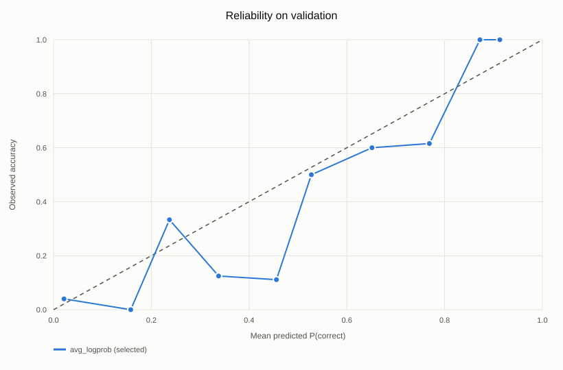
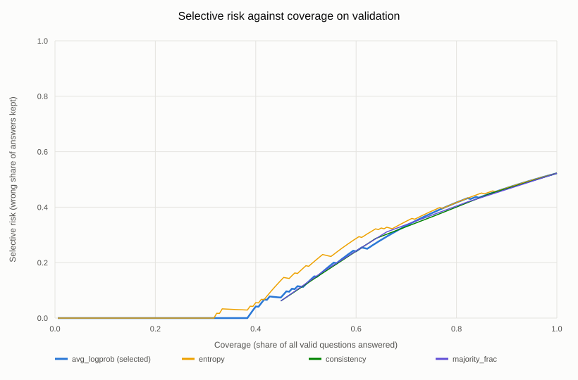

# Confidence calibration: synthetic main_v0, sft_matched, development

Model `Qwen/Qwen2.5-0.5B-Instruct` at `7ae55760`, checkpoint `sft_matched_v0`; prompt `prompt_v0`, decoding `decoding_v1`, grader `p2_whole_word_v5`. Calibrators are fitted on train only and every choice is made on validation. Signals not available: `sum_logprob`, `min_logprob`, `first_token_entropy`, `aux_confidence_score`.

## Inputs

| file | rows | sha256 | arrived graded with | outcomes changed by regrade |
|---|---:|---|---|---:|
| `results/raw/p1_main_v0_sft_matched.jsonl` | 7200 | `5b770e9c7420` | p2_whole_word_v5 | 0 |

## Split counts

Greedy responses, the target being judged.

| split | questions | correct | incorrect | abstain | invalid |
|---|---:|---:|---:|---:|---:|
| train | 420 | 207 | 213 | 0 | 0 |
| validation | 180 | 86 | 94 | 0 | 0 |

## Signal comparison on validation

Attempted greedy answers with a usable signal. Intervals are 95% cluster-bootstrap percentile intervals.
The difference column is AUROC minus `avg_logprob` on the same questions, resampled jointly.

| signal | N (correct/wrong) | AUROC [95% CI] | difference [95% CI] | AUPRC | Brier [95% CI] | base-rate Brier | ECE [95% CI] | ECE read raw |
|---|---:|---:|---:|---:|---:|---:|---:|---:|
| **avg_logprob** | 180 (86/94) | 0.961 [0.919, 0.992] | reference | 0.968 | 0.083 [0.052, 0.115] | 0.250 | 0.096 [0.082, 0.158] | 0.287 |
| entropy | 180 (86/94) | 0.928 [0.874, 0.974] | -0.033 [-0.058, -0.011] | 0.942 | 0.109 [0.072, 0.147] | 0.250 | 0.112 [0.082, 0.179] | N/A |
| consistency | 180 (86/94) | 0.945 [0.898, 0.982] | -0.016 [-0.047, +0.011] | 0.915 | 0.091 [0.058, 0.128] | 0.250 | 0.105 [0.072, 0.161] | 0.170 |
| majority_frac | 180 (86/94) | 0.940 [0.889, 0.980] | -0.021 [-0.053, +0.007] | 0.911 | 0.087 [0.051, 0.128] | 0.250 | 0.082 [0.043, 0.136] | 0.216 |

The selected signal (validation Brier) is in bold. Base-rate Brier predicts the training accuracy (49.3%) for every answer, so a useful signal must beat it. ECE read raw treats the signal itself as a probability (`exp` of a log-probability, or the agreement share); N/A means it has no such reading.

## Abstention policies on validation

Attempted answers below the threshold become abstentions. Rates use all 180 valid questions, abstentions included; selective accuracy uses the answers kept. Thresholds come from validation.

Answering everything: accuracy 47.8%, hallucination 52.2%, abstention 0.0%, coverage 100.0%, selective accuracy 47.8%.

| signal | target coverage | threshold P(correct) | coverage | accuracy | selective accuracy | hallucination | confident errors |
|---|---:|---:|---:|---:|---:|---:|---:|
| avg_logprob | 90% | 0.006 | 90.0% | 47.8% | 53.1% | 42.2% | 76 |
| avg_logprob | 80% | 0.034 | 80.0% | 46.7% | 58.3% | 33.3% | 60 |
| avg_logprob | 70% | 0.141 | 70.0% | 46.7% | 66.7% | 23.3% | 42 |
| avg_logprob | 60% | 0.268 | 60.0% | 45.6% | 75.9% | 14.4% | 26 |
| avg_logprob | 50% | 0.512 | 50.0% | 43.9% | 87.8% | 6.1% | 11 |

Tied scores can make a threshold keep more answers than its target; the coverage column shows what was actually kept.

## Threshold stability

How much the 80%-coverage threshold moves when validation is resampled.

| signal | threshold | 95% interval |
|---|---:|---:|
| avg_logprob | 0.034 | [0.009, 0.105] |
| entropy | 0.032 | [0.011, 0.107] |
| consistency | 0.057 | [0.057, 0.161] |
| majority_frac | 0.061 | [0.013, 0.061] |

## Signal stability across groups

Descriptive. AUROC is N/A where a group has only one outcome. Sampled K does not include the greedy answer being judged, but it shares its samples with the consistency signals.

| signal | grouping | group | questions | correct/wrong | AUROC [95% CI] | Brier | ECE |
|---|---|---|---:|---:|---:|---:|---:|
| avg_logprob | exposure level | 0 | 30 | 0/30 | N/A [N/A, N/A] | 0.078 | 0.206 |
| avg_logprob | exposure level | 1 | 30 | 3/27 | 0.926 [0.769, 1.000] | 0.087 | 0.123 |
| avg_logprob | exposure level | 2 | 30 | 8/22 | 0.881 [0.679, 1.000] | 0.145 | 0.162 |
| avg_logprob | exposure level | 5 | 30 | 22/8 | 0.920 [0.776, 1.000] | 0.090 | 0.099 |
| avg_logprob | exposure level | 10 | 30 | 23/7 | 0.969 [0.871, 1.000] | 0.087 | 0.129 |
| avg_logprob | exposure level | 20 | 30 | 30/0 | N/A [N/A, N/A] | 0.009 | 0.092 |
| avg_logprob | sample knowledge score | 0<K<0.8 | 14 | 6/8 | 0.458 [0.091, 0.917] | 0.359 | 0.407 |
| avg_logprob | sample knowledge score | K=0 | 85 | 0/85 | N/A [N/A, N/A] | 0.080 | 0.179 |
| avg_logprob | sample knowledge score | K>=0.8 | 81 | 80/1 | 1.000 [1.000, 1.000] | 0.038 | 0.143 |

## High-confidence errors on validation

`avg_logprob` at the 80%-coverage threshold (P(correct) >= 0.034): 60 wrong out of 144 answers kept.

| pattern | meaning | count |
|---|---|---:|
| stable_wrong | K=0; the samples repeat the wrong answer | 11 |
| wavering_wrong | K=0; the samples disagree with it | 42 |
| knows_sometimes | K>0; some samples are right | 7 |

Flagged by the shared grader for review: 3. Every error is listed in `confident_errors.csv`.

By exposure level: 0x: 22, 1x: 18, 2x: 7, 5x: 6, 10x: 7.

Most confident errors:

| P(correct) | pattern | question | answer | reference |
|---:|---|---|---|---|
| 0.776 | stable_wrong | Which person is credited with founding the Thunludu Company? | Vlaeshondrar Kunfaek | Suduplen Fouzhom |
| 0.772 | stable_wrong | What trade did Thanzonlouth Trinplouhek practise? | glassblowing | glassblower |
| 0.766 | stable_wrong | Which person is credited with founding the Moukrinzhaek Institute? | Gluvlenrom Shishoumoun | Gluvlenrom Shifoun |
| 0.744 | knows_sometimes | When was Zunluzaes Naglar born? Give the year. | 1878 | 1978 |
| 0.743 | stable_wrong | Who set up the Moukrinzhaek Institute? | Gluvlenrom Shishoumoun | Gluvlenrom Shifoun |
| 0.687 | wavering_wrong | Who set up the Thunludu Company? | Vlaeshondrar Kunfaek | Suduplen Fouzhom |
| 0.652 | wavering_wrong | What kind of work was Kedrounshaen Drunfanvaes known for? | tapestry weaver | cobbler |
| 0.651 | knows_sometimes | What kind of work was Banbrenan Zhaemem known for? | ferryman | falconer |
| 0.628 | knows_sometimes | Can you tell me the year Zunluzaes Naglar was born? | 1878 | 1978 |
| 0.557 | stable_wrong | What is the home city of the Ramour Institute? | Vlaeplivla | Zhenshousik |
| 0.512 | wavering_wrong | What kind of work was Vaedoude Zekrunglom known for? | lens grinder | fletcher |
| 0.496 | wavering_wrong | What city serves as the seat of government of Lonploufo? | Vlouvlitrouth | Nadodru |
| 0.496 | wavering_wrong | When was Gaemon Vlebraevlaek born? Give the year. | 1873 | 1880 |
| 0.488 | stable_wrong | Can you tell me the year Poglin Trutronir was born? | 1862 | 1930 |
| 0.451 | stable_wrong | When was Nazubal Shanfar born? Give the year. | 1922 | 1926 |

Reliability bins holding few answers are noisy; their counts are in the JSON results.

