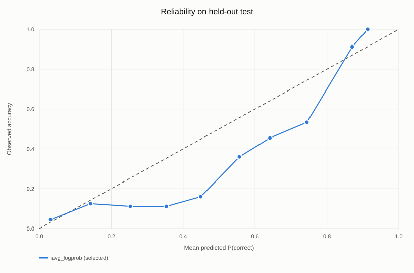
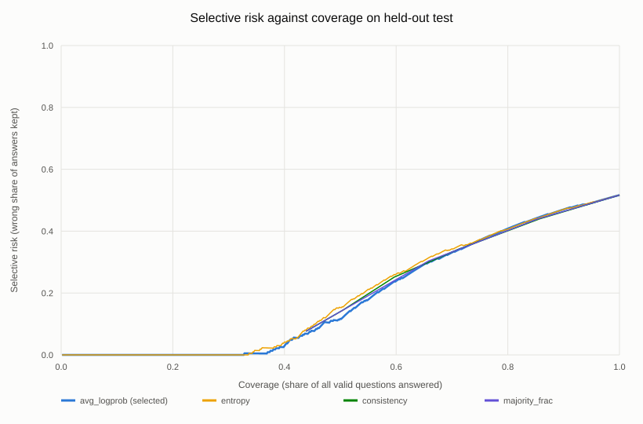

# Confidence calibration: synthetic main_v0, sft_matched, held-out final split

Model `Qwen/Qwen2.5-0.5B-Instruct` at `7ae55760`, checkpoint `sft_matched_v0`; prompt `prompt_v0`, decoding `decoding_v1`, grader `p2_whole_word_v5`. Calibrators are fitted on train only and every choice is made on validation. Signals not available: `sum_logprob`, `min_logprob`, `first_token_entropy`, `aux_confidence_score`.

Frozen policy `cb392b57de50`, fitted on `sft_matched_v0` / `synthetic-main_v0`, applied unchanged. Nothing was refitted or reselected.

## Inputs

| file | rows | sha256 | arrived graded with | outcomes changed by regrade |
|---|---:|---|---|---:|
| `results/raw/p1_main_v0_sft_matched.jsonl` | 7200 | `5b770e9c7420` | p2_whole_word_v5 | 0 |

## Split counts

Greedy responses, the target being judged.

| split | questions | correct | incorrect | abstain | invalid |
|---|---:|---:|---:|---:|---:|
| held-out test | 600 | 290 | 310 | 0 | 0 |

## Signal comparison on held-out test

Attempted greedy answers with a usable signal. Intervals are 95% cluster-bootstrap percentile intervals.
The difference column is AUROC minus `avg_logprob` on the same questions, resampled jointly.

| signal | N (correct/wrong) | AUROC [95% CI] | difference [95% CI] | AUPRC | Brier [95% CI] | base-rate Brier | ECE [95% CI] | ECE read raw |
|---|---:|---:|---:|---:|---:|---:|---:|---:|
| **avg_logprob** | 600 (290/310) | 0.954 [0.933, 0.973] | reference | 0.964 | 0.087 [0.071, 0.106] | 0.250 | 0.086 [0.069, 0.114] | 0.287 |
| entropy | 600 (290/310) | 0.939 [0.915, 0.961] | -0.015 [-0.027, -0.006] | 0.952 | 0.103 [0.087, 0.120] | 0.250 | 0.102 [0.086, 0.138] | N/A |
| consistency | 600 (290/310) | 0.923 [0.897, 0.949] | -0.031 [-0.052, -0.010] | 0.891 | 0.102 [0.082, 0.122] | 0.250 | 0.072 [0.050, 0.101] | 0.145 |
| majority_frac | 600 (290/310) | 0.921 [0.893, 0.946] | -0.033 [-0.055, -0.012] | 0.888 | 0.096 [0.076, 0.117] | 0.250 | 0.052 [0.030, 0.078] | 0.208 |

The selected signal (validation Brier) is in bold. Base-rate Brier predicts the training accuracy (49.3%) for every answer, so a useful signal must beat it. ECE read raw treats the signal itself as a probability (`exp` of a log-probability, or the agreement share); N/A means it has no such reading.

## Abstention policies on held-out test

Attempted answers below the threshold become abstentions. Rates use all 600 valid questions, abstentions included; selective accuracy uses the answers kept. Thresholds come from validation.

Answering everything: accuracy 48.3%, hallucination 51.7%, abstention 0.0%, coverage 100.0%, selective accuracy 48.3%.

| signal | target coverage | threshold P(correct) | coverage | accuracy | selective accuracy | hallucination | confident errors |
|---|---:|---:|---:|---:|---:|---:|---:|
| avg_logprob | 90% | 0.006 | 93.7% | 48.2% | 51.4% | 45.5% | 273 |
| avg_logprob | 80% | 0.034 | 84.2% | 47.5% | 56.4% | 36.7% | 220 |
| avg_logprob | 70% | 0.141 | 68.7% | 46.7% | 68.0% | 22.0% | 132 |
| avg_logprob | 60% | 0.268 | 61.3% | 46.0% | 75.0% | 15.3% | 92 |
| avg_logprob | 50% | 0.512 | 52.0% | 44.5% | 85.6% | 7.5% | 45 |

Tied scores can make a threshold keep more answers than its target; the coverage column shows what was actually kept.

## Signal stability across groups

Descriptive. AUROC is N/A where a group has only one outcome. Sampled K does not include the greedy answer being judged, but it shares its samples with the consistency signals.

| signal | grouping | group | questions | correct/wrong | AUROC [95% CI] | Brier | ECE |
|---|---|---|---:|---:|---:|---:|---:|
| avg_logprob | exposure level | 0 | 100 | 2/98 | 0.413 [0.311, 0.514] | 0.119 | 0.189 |
| avg_logprob | exposure level | 1 | 100 | 6/94 | 0.887 [0.688, 1.000] | 0.081 | 0.136 |
| avg_logprob | exposure level | 2 | 100 | 26/74 | 0.818 [0.659, 0.925] | 0.149 | 0.146 |
| avg_logprob | exposure level | 5 | 100 | 72/28 | 0.949 [0.897, 0.987] | 0.098 | 0.144 |
| avg_logprob | exposure level | 10 | 100 | 89/11 | 0.969 [0.910, 1.000] | 0.054 | 0.118 |
| avg_logprob | exposure level | 20 | 100 | 95/5 | 0.989 [0.957, 1.000] | 0.023 | 0.102 |
| avg_logprob | sample knowledge score | 0<K<0.8 | 66 | 29/37 | 0.686 [0.523, 0.840] | 0.250 | 0.222 |
| avg_logprob | sample knowledge score | K=0 | 275 | 2/273 | 0.284 [0.106, 0.476] | 0.106 | 0.201 |
| avg_logprob | sample knowledge score | K>=0.8 | 259 | 259/0 | N/A [N/A, N/A] | 0.026 | 0.127 |

## High-confidence errors on held-out test

`avg_logprob` at the 80%-coverage threshold (P(correct) >= 0.034): 220 wrong out of 505 answers kept.

| pattern | meaning | count |
|---|---|---:|
| stable_wrong | K=0; the samples repeat the wrong answer | 37 |
| wavering_wrong | K=0; the samples disagree with it | 155 |
| knows_sometimes | K>0; some samples are right | 28 |

Flagged by the shared grader for review: 2. Every error is listed in `confident_errors.csv`.

By exposure level: 0x: 65, 1x: 67, 2x: 51, 5x: 21, 10x: 11, 20x: 5.

Most confident errors:

| P(correct) | pattern | question | answer | reference |
|---:|---|---|---|---|
| 0.884 | stable_wrong | Which line of work was Mumaethor Maehounkrem in? | stonemason | violin maker |
| 0.855 | stable_wrong | The Brounzouves Foundry owes its founding to which person? | Vounponvlir Mufeth | Soupubre Trathaezir |
| 0.849 | stable_wrong | Which line of work was Haedradru Thidri in? | ferryman | falconer |
| 0.845 | stable_wrong | Who started the Brounzouves Foundry? | Vounponvlir Mufeth | Soupubre Trathaezir |
| 0.830 | stable_wrong | What year did Thoglu Draeneze come into the world? | 1880 | 1905 |
| 0.822 | stable_wrong | How did Mumaethor Maehounkrem earn a living? | stonemason | violin maker |
| 0.797 | stable_wrong | The Kraemodrak Institute operates out of which city? | Sovinbrouk | Konouth |
| 0.796 | stable_wrong | What is the name of Zhouroutek's capital? | Lanfourum | Lekraenvlik |
| 0.791 | stable_wrong | Which city does Zhouroutek govern from? | Lanfourum | Lekraenvlik |
| 0.778 | stable_wrong | The person named Thoglu Draeneze was born in what year? | 1880 | 1905 |
| 0.777 | stable_wrong | How did Haedradru Thidri earn a living? | ferryman | falconer |
| 0.769 | wavering_wrong | The Dranobum Guild owes its founding to which person? | Nidous Vleshentraek | Nidous Vleshentra |
| 0.754 | knows_sometimes | What year did Dundouvlor Zhabounthaer come into the world? | 1941 | 1961 |
| 0.745 | wavering_wrong | Who started the Dranobum Guild? | Nidous Vleshentraek | Nidous Vleshentra |
| 0.730 | wavering_wrong | The person named Dundouvlor Zhabounthaer was born in what year? | 1941 | 1961 |

Reliability bins holding few answers are noisy; their counts are in the JSON results.

