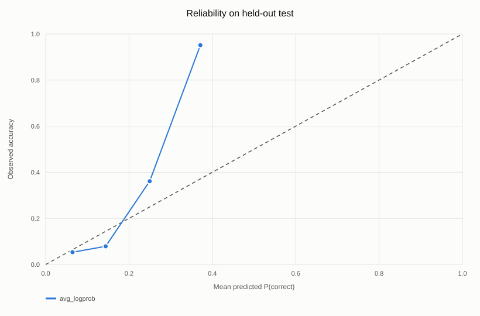
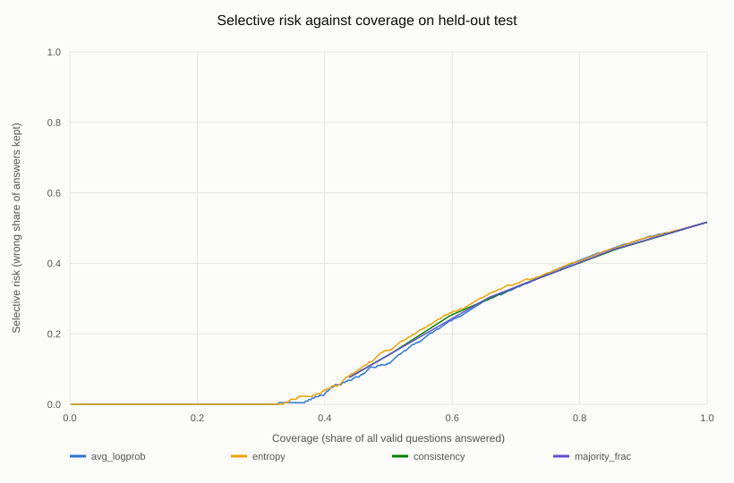

# Transfer: TriviaQA base policy on sft_matched, final split

Model `Qwen/Qwen2.5-0.5B-Instruct` at `7ae55760`, checkpoint `sft_matched_v0`; prompt `prompt_v0`, decoding `decoding_v1`, grader `p2_whole_word_v5`. Calibrators are fitted on train only and every choice is made on validation. Signals not available: `aux_confidence_score`, `sum_logprob`, `min_logprob`, `first_token_entropy`.

Frozen policy `6f5e83175a5f`, fitted on `Qwen/Qwen2.5-0.5B-Instruct-base` / `triviaqa-v0`, applied unchanged as a transfer test: this model or dataset differs from the one it was fitted on.

## Inputs

| file | rows | sha256 | arrived graded with | outcomes changed by regrade |
|---|---:|---|---|---:|
| `results/raw/p1_main_v0_sft_matched.jsonl` | 7200 | `5b770e9c7420` | p2_whole_word_v5 | 0 |

## Split counts

Greedy responses, the target being judged.

| split | questions | correct | incorrect | abstain | invalid |
|---|---:|---:|---:|---:|---:|
| held-out test | 600 | 290 | 310 | 0 | 0 |

## Signal comparison on held-out test

Attempted greedy answers with a usable signal. Intervals are 95% cluster-bootstrap percentile intervals.
The difference column is AUROC minus `avg_logprob` on the same questions, resampled jointly.

| signal | N (correct/wrong) | AUROC [95% CI] | difference [95% CI] | AUPRC | Brier [95% CI] | base-rate Brier | ECE [95% CI] | ECE read raw |
|---|---:|---:|---:|---:|---:|---:|---:|---:|
| avg_logprob | 600 (290/310) | 0.954 [0.933, 0.973] | reference | 0.964 | 0.224 [0.203, 0.246] | 0.336 | 0.276 [0.239, 0.317] | 0.287 |
| entropy | 600 (290/310) | 0.939 [0.915, 0.961] | -0.015 [-0.027, -0.006] | 0.952 | 0.231 [0.208, 0.254] | 0.336 | 0.263 [0.227, 0.307] | N/A |
| consistency | 600 (290/310) | 0.923 [0.897, 0.949] | -0.031 [-0.052, -0.010] | 0.891 | 0.143 [0.130, 0.155] | 0.336 | 0.190 [0.164, 0.224] | 0.145 |
| majority_frac | 600 (290/310) | 0.921 [0.893, 0.946] | -0.033 [-0.055, -0.012] | 0.888 | 0.140 [0.128, 0.153] | 0.336 | 0.184 [0.156, 0.219] | 0.208 |

The selected signal (validation Brier) is in bold. Base-rate Brier predicts the training accuracy (18.9%) for every answer, so a useful signal must beat it. ECE read raw treats the signal itself as a probability (`exp` of a log-probability, or the agreement share); N/A means it has no such reading.

## Abstention policies on held-out test

Attempted answers below the threshold become abstentions. Rates use all 600 valid questions, abstentions included; selective accuracy uses the answers kept. Thresholds come from validation.

Answering everything: accuracy 48.3%, hallucination 51.7%, abstention 0.0%, coverage 100.0%, selective accuracy 48.3%.

| signal | target coverage | threshold P(correct) | coverage | accuracy | selective accuracy | hallucination | confident errors |
|---|---:|---:|---:|---:|---:|---:|---:|
| avg_logprob | 90% | 0.005 | 100.0% | 48.3% | 48.3% | 51.7% | 310 |
| avg_logprob | 80% | 0.088 | 88.2% | 47.7% | 54.1% | 40.5% | 243 |
| avg_logprob | 70% | 0.145 | 71.0% | 47.0% | 66.2% | 24.0% | 144 |
| avg_logprob | 60% | 0.179 | 63.0% | 46.0% | 73.0% | 17.0% | 102 |
| avg_logprob | 50% | 0.204 | 58.2% | 45.5% | 78.2% | 12.7% | 76 |

Tied scores can make a threshold keep more answers than its target; the coverage column shows what was actually kept.

## Signal stability across groups

Descriptive. AUROC is N/A where a group has only one outcome. Sampled K does not include the greedy answer being judged, but it shares its samples with the consistency signals.

| signal | grouping | group | questions | correct/wrong | AUROC [95% CI] | Brier | ECE |
|---|---|---|---:|---:|---:|---:|---:|
| avg_logprob | exposure level | 0 | 100 | 2/98 | 0.413 [0.311, 0.514] | 0.043 | 0.127 |
| avg_logprob | exposure level | 1 | 100 | 6/94 | 0.887 [0.688, 1.000] | 0.056 | 0.100 |
| avg_logprob | exposure level | 2 | 100 | 26/74 | 0.818 [0.659, 0.925] | 0.161 | 0.103 |
| avg_logprob | exposure level | 5 | 100 | 72/28 | 0.949 [0.897, 0.987] | 0.343 | 0.450 |
| avg_logprob | exposure level | 10 | 100 | 89/11 | 0.969 [0.910, 1.000] | 0.369 | 0.545 |
| avg_logprob | exposure level | 20 | 100 | 95/5 | 0.989 [0.957, 1.000] | 0.373 | 0.591 |
| avg_logprob | sample knowledge score | 0<K<0.8 | 66 | 29/37 | 0.686 [0.523, 0.840] | 0.298 | 0.266 |
| avg_logprob | sample knowledge score | K=0 | 275 | 2/273 | 0.284 [0.106, 0.476] | 0.034 | 0.141 |
| avg_logprob | sample knowledge score | K>=0.8 | 259 | 259/0 | N/A [N/A, N/A] | 0.407 | 0.637 |

Reliability bins holding few answers are noisy; their counts are in the JSON results.

