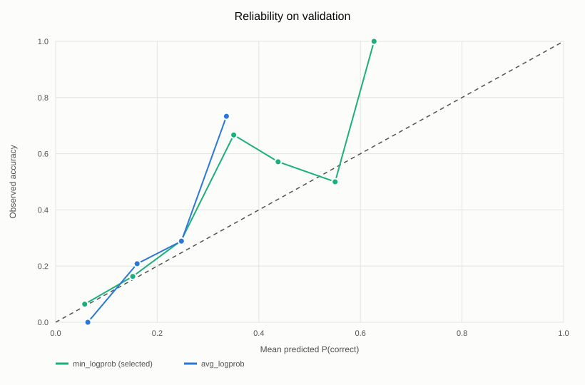
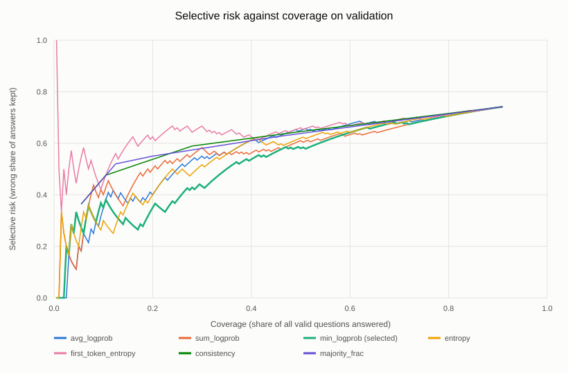

# Confidence calibration: TriviaQA base model, development

Model `Qwen/Qwen2.5-0.5B-Instruct` at `7ae55760`, checkpoint `Qwen/Qwen2.5-0.5B-Instruct-base`; prompt `prompt_v0`, decoding `decoding_v1`, grader `p2_whole_word_v5`. Calibrators are fitted on train only and every choice is made on validation. Signals not available: `aux_confidence_score`.

## Inputs

| file | rows | sha256 | arrived graded with | outcomes changed by regrade |
|---|---:|---|---|---:|
| `results/raw/confidence_calibration/triviaqa_v0_base/scored_responses.jsonl` | 4200 | `17bc8169c65c` | p2_whole_word_v5 | 0 |

## Split counts

Greedy responses, the target being judged.

| split | questions | correct | incorrect | abstain | invalid |
|---|---:|---:|---:|---:|---:|
| train | 500 | 88 | 378 | 34 | 0 |
| validation | 200 | 47 | 135 | 18 | 0 |

## Signal comparison on validation

Attempted greedy answers with a usable signal. Intervals are 95% cluster-bootstrap percentile intervals.
The difference column is AUROC minus `avg_logprob` on the same questions, resampled jointly.

| signal | N (correct/wrong) | AUROC [95% CI] | difference [95% CI] | AUPRC | Brier [95% CI] | base-rate Brier | ECE [95% CI] | ECE read raw |
|---|---:|---:|---:|---:|---:|---:|---:|---:|
| avg_logprob | 182 (47/135) | 0.747 [0.662, 0.831] | reference | 0.575 | 0.174 [0.140, 0.207] | 0.196 | 0.076 [0.043, 0.135] | 0.450 |
| sum_logprob | 182 (47/135) | 0.777 [0.703, 0.842] | +0.030 [-0.052, +0.117] | 0.549 | 0.166 [0.132, 0.200] | 0.196 | 0.088 [0.047, 0.144] | 0.195 |
| **min_logprob** | 182 (47/135) | 0.827 [0.756, 0.888] | +0.081 [-0.003, +0.165] | 0.637 | 0.149 [0.117, 0.181] | 0.196 | 0.064 [0.048, 0.129] | 0.068 |
| entropy | 182 (47/135) | 0.771 [0.689, 0.848] | +0.024 [-0.007, +0.058] | 0.576 | 0.172 [0.139, 0.205] | 0.196 | 0.079 [0.047, 0.141] | N/A |
| first_token_entropy | 182 (47/135) | 0.668 [0.577, 0.756] | -0.079 [-0.182, +0.018] | 0.398 | 0.187 [0.148, 0.224] | 0.196 | 0.078 [0.032, 0.143] | N/A |
| consistency | 182 (47/135) | 0.677 [0.587, 0.762] | -0.070 [-0.161, +0.026] | 0.409 | 0.180 [0.138, 0.219] | 0.196 | 0.072 [0.040, 0.142] | 0.154 |
| majority_frac | 182 (47/135) | 0.678 [0.592, 0.764] | -0.069 [-0.154, +0.024] | 0.402 | 0.181 [0.141, 0.219] | 0.196 | 0.079 [0.042, 0.148] | 0.125 |

Length baseline: answer length alone (shorter = right) reaches AUROC 0.640. The answer-length rows under signal stability show whether a signal still separates outcomes among answers of similar length.

The selected signal (validation Brier) is in bold. Base-rate Brier predicts the training accuracy (18.9%) for every answer, so a useful signal must beat it. ECE read raw treats the signal itself as a probability (`exp` of a log-probability, or the agreement share); N/A means it has no such reading.

## Abstention policies on validation

Attempted answers below the threshold become abstentions. Rates use all 200 valid questions, abstentions included; selective accuracy uses the answers kept. Thresholds come from validation.

Answering everything: accuracy 23.5%, hallucination 67.5%, abstention 9.0%, coverage 91.0%, selective accuracy 25.8%.

| signal | target coverage | threshold P(correct) | coverage | accuracy | selective accuracy | hallucination | confident errors |
|---|---:|---:|---:|---:|---:|---:|---:|
| min_logprob | 90% | 0.011 | 90.0% | 23.5% | 26.1% | 66.5% | 133 |
| min_logprob | 80% | 0.042 | 80.0% | 23.5% | 29.4% | 56.5% | 113 |
| min_logprob | 70% | 0.076 | 70.0% | 22.5% | 32.1% | 47.5% | 95 |
| min_logprob | 60% | 0.104 | 60.0% | 21.5% | 35.8% | 38.5% | 77 |
| min_logprob | 50% | 0.146 | 50.0% | 21.0% | 42.0% | 29.0% | 58 |
| avg_logprob | 90% | 0.005 | 90.0% | 23.5% | 26.1% | 66.5% | 133 |
| avg_logprob | 80% | 0.088 | 80.0% | 23.5% | 29.4% | 56.5% | 113 |
| avg_logprob | 70% | 0.145 | 70.0% | 22.5% | 32.1% | 47.5% | 95 |
| avg_logprob | 60% | 0.179 | 60.0% | 19.5% | 32.5% | 40.5% | 81 |
| avg_logprob | 50% | 0.204 | 50.0% | 17.5% | 35.0% | 32.5% | 65 |

Tied scores can make a threshold keep more answers than its target; the coverage column shows what was actually kept.

## Threshold stability

How much the 80%-coverage threshold moves when validation is resampled.

| signal | threshold | 95% interval |
|---|---:|---:|
| avg_logprob | 0.088 | [0.063, 0.111] |
| sum_logprob | 0.042 | [0.024, 0.084] |
| min_logprob | 0.042 | [0.034, 0.061] |
| entropy | 0.097 | [0.068, 0.134] |
| first_token_entropy | 0.111 | [0.096, 0.125] |
| consistency | 0.096 | [0.096, 0.096] |
| majority_frac | 0.098 | [0.098, 0.098] |

## Signal stability across groups

Descriptive. AUROC is N/A where a group has only one outcome. Sampled K does not include the greedy answer being judged, but it shares its samples with the consistency signals.

| signal | grouping | group | questions | correct/wrong | AUROC [95% CI] | Brier | ECE |
|---|---|---|---:|---:|---:|---:|---:|
| min_logprob | answer length tokens | 01-03 | 16 | 3/13 | 1.000 [1.000, 1.000] | 0.088 | 0.209 |
| min_logprob | answer length tokens | 04-12 | 56 | 15/23 | 0.835 [0.689, 0.958] | 0.199 | 0.168 |
| min_logprob | answer length tokens | 13+ | 128 | 29/99 | 0.823 [0.735, 0.895] | 0.142 | 0.059 |
| min_logprob | sample knowledge score | 0<K<0.8 | 40 | 17/22 | 0.631 [0.447, 0.810] | 0.287 | 0.252 |
| min_logprob | sample knowledge score | K=0 | 132 | 2/113 | 0.381 [0.271, 0.490] | 0.048 | 0.124 |
| min_logprob | sample knowledge score | K>=0.8 | 28 | 28/0 | N/A [N/A, N/A] | 0.374 | 0.597 |
| avg_logprob | answer length tokens | 01-03 | 16 | 3/13 | 0.949 [0.786, 1.000] | 0.127 | 0.141 |
| avg_logprob | answer length tokens | 04-12 | 56 | 15/23 | 0.739 [0.551, 0.888] | 0.245 | 0.208 |
| avg_logprob | answer length tokens | 13+ | 128 | 29/99 | 0.747 [0.643, 0.838] | 0.159 | 0.053 |
| avg_logprob | sample knowledge score | 0<K<0.8 | 40 | 17/22 | 0.658 [0.474, 0.826] | 0.282 | 0.229 |
| avg_logprob | sample knowledge score | K=0 | 132 | 2/113 | 0.442 [0.283, 0.605] | 0.050 | 0.165 |
| avg_logprob | sample knowledge score | K>=0.8 | 28 | 28/0 | N/A [N/A, N/A] | 0.532 | 0.726 |

## High-confidence errors on validation

`min_logprob` at the 80%-coverage threshold (P(correct) >= 0.042): 113 wrong out of 160 answers kept.

| pattern | meaning | count |
|---|---|---:|
| stable_wrong | K=0; the samples repeat the wrong answer | 9 |
| wavering_wrong | K=0; the samples disagree with it | 83 |
| knows_sometimes | K>0; some samples are right | 21 |

Flagged by the shared grader for review: 36. Every error is listed in `confident_errors.csv`.

Most confident errors:

| P(correct) | pattern | question | answer | reference |
|---:|---|---|---|---|
| 0.596 | stable_wrong | Argentina invaded UK's Falkland Islands, Israel invaded Southern Lebanon, Canada became officially independen… | 1989 | 1982 |
| 0.520 | knows_sometimes | Which modern day country was known until 1981 as British Honduras? | British Honduras was known as British Honduras until 1981. | BELIZE |
| 0.496 | wavering_wrong | In what year did Elvis Presley and his parents move from Tupelo to Memphis? | Elvis Presley and his parents moved from Tupelo, Mississippi, to Memphis, Tennessee in 1954. | 1948 |
| 0.443 | stable_wrong | The town of Budge Budge is in which country? | The town of Budge Budge is in the United Kingdom. | India |
| 0.442 | wavering_wrong | What was the name of the old Waddington’s game based on newspapers? | The old Waddington’s game was based on newspapers. | Scoop |
| 0.418 | stable_wrong | For what did Einstien gat Nobel prize in Physics? | Einstein received the Nobel Prize in Physics in 1921 for his theory of relativity. | The photoelectric effect |
| 0.410 | wavering_wrong | Who created Rumpole of the Bailey? | The character Rumpole of the Bailey was created by Sir Arthur Conan Doyle. | John Mortimer |
| 0.403 | stable_wrong | When Alexander the Great had an Empire to which Asian Country did it stretch? | Asia. | INDIA |
| 0.368 | stable_wrong | How many heads did the Hydra have? | The Hydra had 8 heads. | Nine |
| 0.334 | knows_sometimes | Mistral, chinook, zonda, and willy-willy are types of which planet Earth feature? | Mistral, chinook, zonda, and willy-willy are types of clouds. | Winds |
| 0.322 | stable_wrong | Pony, seven and schooner are Australian terms for what? | Schooner | Beer glasses |
| 0.320 | wavering_wrong | Which ‘A’ is a calculating frame with sliding balls on wires? | The 'A' is a calculating frame with sliding balls on wires. | Abacus |
| 0.304 | wavering_wrong | The Misses World for both 1999 and 2000 represented which country? | The Misses World for both 1999 and 2000 represented the United States. | India |
| 0.303 | knows_sometimes | Vancouver is not the first Canadian city to host the winter Olympics. What city holds that honor when they ho… | Vancouver holds the honor of hosting the 1988 Winter Olympics. | Calgary, Alberta |
| 0.296 | knows_sometimes | Which country used to be called Southern Rhodesia? | South Africa | Zimbabwe |

Reliability bins holding few answers are noisy; their counts are in the JSON results.

