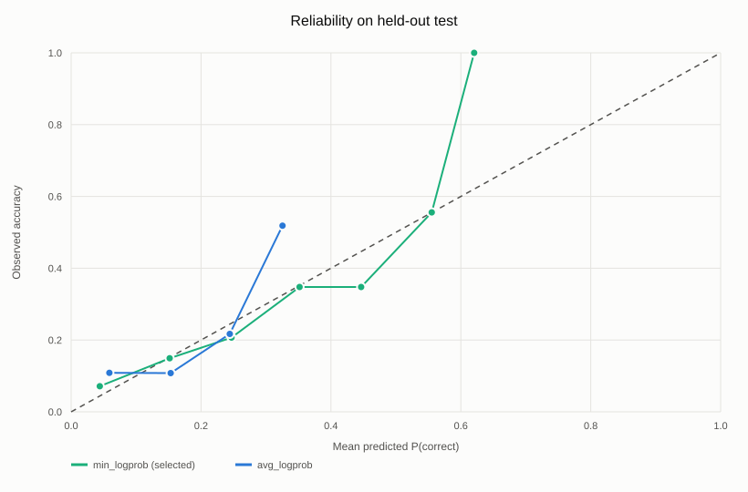
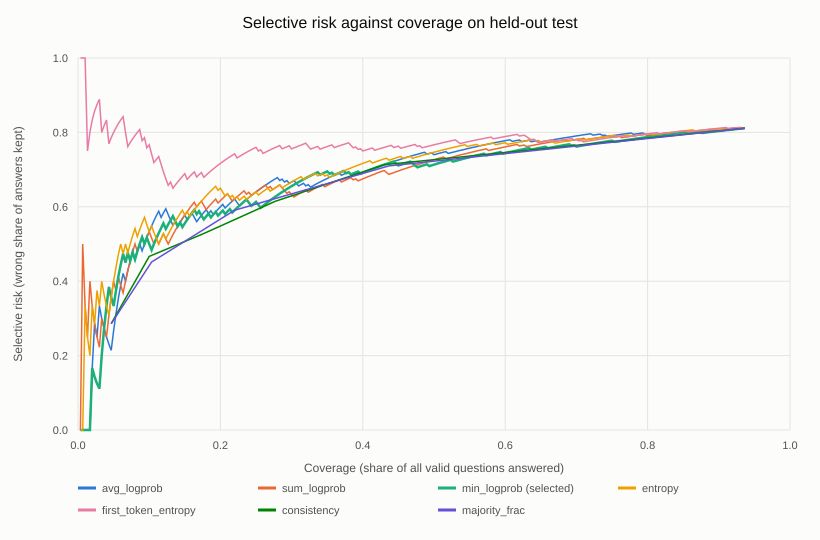

# held_out

Model `Qwen/Qwen2.5-0.5B-Instruct` at `7ae55760`, checkpoint `Qwen/Qwen2.5-0.5B-Instruct-base`; prompt `prompt_v0`, decoding `decoding_v1`, grader `p2_whole_word_v5`. Calibrators are fitted on train only and every choice is made on validation. Signals not available: `aux_confidence_score`.

Frozen policy `6f5e83175a5f`, fitted on `Qwen/Qwen2.5-0.5B-Instruct-base` / `triviaqa-v0`, applied unchanged. Nothing was refitted or reselected.

## Inputs

| file | rows | sha256 | arrived graded with | outcomes changed by regrade |
|---|---:|---|---|---:|
| `results/raw/confidence_calibration/triviaqa_v0_base/scored_held_out.jsonl` | 1800 | `0513e08f9fbb` | p2_whole_word_v5 | 0 |

## Split counts

Greedy responses, the target being judged.

| split | questions | correct | incorrect | abstain | invalid |
|---|---:|---:|---:|---:|---:|
| held-out test | 300 | 53 | 228 | 19 | 0 |

## Signal comparison on held-out test

Attempted greedy answers with a usable signal. Intervals are 95% cluster-bootstrap percentile intervals.
The difference column is AUROC minus `avg_logprob` on the same questions, resampled jointly.

| signal | N (correct/wrong) | AUROC [95% CI] | difference [95% CI] | AUPRC | Brier [95% CI] | base-rate Brier | ECE [95% CI] | ECE read raw |
|---|---:|---:|---:|---:|---:|---:|---:|---:|
| avg_logprob | 281 (53/228) | 0.693 [0.607, 0.782] | reference | 0.444 | 0.142 [0.116, 0.168] | 0.153 | 0.053 [0.029, 0.099] | 0.496 |
| sum_logprob | 281 (53/228) | 0.718 [0.634, 0.797] | +0.024 [-0.047, +0.110] | 0.429 | 0.138 [0.113, 0.165] | 0.153 | 0.060 [0.036, 0.105] | 0.117 |
| **min_logprob** | 281 (53/228) | 0.733 [0.659, 0.806] | +0.040 [-0.033, +0.114] | 0.461 | 0.134 [0.110, 0.160] | 0.153 | 0.031 [0.028, 0.089] | 0.061 |
| entropy | 281 (53/228) | 0.684 [0.598, 0.776] | -0.009 [-0.036, +0.018] | 0.405 | 0.144 [0.117, 0.169] | 0.153 | 0.037 [0.020, 0.082] | N/A |
| first_token_entropy | 281 (53/228) | 0.602 [0.514, 0.680] | -0.091 [-0.192, -0.001] | 0.245 | 0.150 [0.122, 0.178] | 0.153 | 0.019 [0.014, 0.075] | N/A |
| consistency | 281 (53/228) | 0.714 [0.633, 0.795] | +0.020 [-0.067, +0.115] | 0.410 | 0.131 [0.105, 0.158] | 0.153 | 0.027 [0.022, 0.080] | 0.145 |
| majority_frac | 281 (53/228) | 0.712 [0.629, 0.790] | +0.018 [-0.066, +0.110] | 0.398 | 0.131 [0.107, 0.160] | 0.153 | 0.010 [0.016, 0.069] | 0.184 |

Length baseline: answer length alone (shorter = right) reaches AUROC 0.607. The answer-length rows under signal stability show whether a signal still separates outcomes among answers of similar length.

The selected signal (validation Brier) is in bold. Base-rate Brier predicts the training accuracy (18.9%) for every answer, so a useful signal must beat it. ECE read raw treats the signal itself as a probability (`exp` of a log-probability, or the agreement share); N/A means it has no such reading.

## Abstention policies on held-out test

Attempted answers below the threshold become abstentions. Rates use all 300 valid questions, abstentions included; selective accuracy uses the answers kept. Thresholds come from validation.

Answering everything: accuracy 17.7%, hallucination 76.0%, abstention 6.3%, coverage 93.7%, selective accuracy 18.9%.

| signal | target coverage | threshold P(correct) | coverage | accuracy | selective accuracy | hallucination | confident errors |
|---|---:|---:|---:|---:|---:|---:|---:|
| min_logprob | 90% | 0.011 | 89.7% | 17.7% | 19.7% | 72.0% | 216 |
| min_logprob | 80% | 0.042 | 76.7% | 17.0% | 22.2% | 59.7% | 179 |
| min_logprob | 70% | 0.076 | 66.0% | 16.0% | 24.2% | 50.0% | 150 |
| min_logprob | 60% | 0.104 | 61.0% | 15.3% | 25.1% | 45.7% | 137 |
| min_logprob | 50% | 0.146 | 50.7% | 14.3% | 28.3% | 36.3% | 109 |
| avg_logprob | 90% | 0.005 | 92.3% | 17.7% | 19.1% | 74.7% | 224 |
| avg_logprob | 80% | 0.088 | 82.3% | 17.0% | 20.6% | 65.3% | 196 |
| avg_logprob | 70% | 0.145 | 65.7% | 14.7% | 22.3% | 51.0% | 153 |
| avg_logprob | 60% | 0.179 | 52.0% | 13.3% | 25.6% | 38.7% | 116 |
| avg_logprob | 50% | 0.204 | 42.7% | 12.3% | 28.9% | 30.3% | 91 |

Tied scores can make a threshold keep more answers than its target; the coverage column shows what was actually kept.

## Signal stability across groups

Descriptive. AUROC is N/A where a group has only one outcome. Sampled K does not include the greedy answer being judged, but it shares its samples with the consistency signals.

| signal | grouping | group | questions | correct/wrong | AUROC [95% CI] | Brier | ECE |
|---|---|---|---:|---:|---:|---:|---:|
| min_logprob | answer length tokens | 01-03 | 35 | 9/26 | 0.650 [0.400, 0.860] | 0.193 | 0.138 |
| min_logprob | answer length tokens | 04-12 | 73 | 11/43 | 0.888 [0.760, 0.987] | 0.114 | 0.133 |
| min_logprob | answer length tokens | 13+ | 192 | 33/159 | 0.721 [0.622, 0.817] | 0.129 | 0.028 |
| min_logprob | sample knowledge score | 0<K<0.8 | 46 | 17/26 | 0.369 [0.204, 0.537] | 0.319 | 0.263 |
| min_logprob | sample knowledge score | K=0 | 217 | 1/200 | 0.530 [0.462, 0.591] | 0.046 | 0.153 |
| min_logprob | sample knowledge score | K>=0.8 | 37 | 35/2 | 0.543 [0.382, 0.714] | 0.396 | 0.571 |
| avg_logprob | answer length tokens | 01-03 | 35 | 9/26 | 0.705 [0.495, 0.876] | 0.192 | 0.151 |
| avg_logprob | answer length tokens | 04-12 | 73 | 11/43 | 0.892 [0.750, 0.988] | 0.131 | 0.127 |
| avg_logprob | answer length tokens | 13+ | 192 | 33/159 | 0.664 [0.557, 0.768] | 0.136 | 0.037 |
| avg_logprob | sample knowledge score | 0<K<0.8 | 46 | 17/26 | 0.475 [0.289, 0.661] | 0.292 | 0.223 |
| avg_logprob | sample knowledge score | K=0 | 217 | 1/200 | 0.735 [0.680, 0.796] | 0.040 | 0.171 |
| avg_logprob | sample knowledge score | K>=0.8 | 37 | 35/2 | 0.543 [0.194, 0.886] | 0.523 | 0.683 |

## High-confidence errors on held-out test

`min_logprob` at the 80%-coverage threshold (P(correct) >= 0.042): 179 wrong out of 230 answers kept.

| pattern | meaning | count |
|---|---|---:|
| stable_wrong | K=0; the samples repeat the wrong answer | 13 |
| wavering_wrong | K=0; the samples disagree with it | 139 |
| knows_sometimes | K>0; some samples are right | 27 |

Flagged by the shared grader for review: 59. Every error is listed in `confident_errors.csv`.

Most confident errors:

| P(correct) | pattern | question | answer | reference |
|---:|---|---|---|---|
| 0.566 | stable_wrong | Which state was created by the Lateran Treaty of 1929? | Italy | VATICAN CITY |
| 0.541 | stable_wrong | Which cocktail comprises Tequila, Lime or Lemon juice, and Orange-flavoured liqueur? | Tequila | MARGARITA |
| 0.537 | stable_wrong | What is the name of the island that separates the two largest waterfalls at Niagara ? | Niagara Falls | GOAT ISLAND |
| 0.534 | stable_wrong | In the British Parliament, who presides over the election of a new Speaker? | The Speaker of the House of Commons presides over the election of a new Speaker. | The Father of the House |
| 0.499 | wavering_wrong | "The musical ""Jersey Boys"" is based around the music-of-which American pop group?" | The musical "Jersey Boys" is based around the music of the American pop group The Beatles. | The Four Seasons |
| 0.471 | stable_wrong | "The TV series ""Married... with Children"" was set in which city?" | New York City | Chicago |
| 0.470 | wavering_wrong | Which quadrilateral has one pair of parallel edges of unequal length? | The quadrilateral with one pair of parallel edges of unequal length is a trapezoid. | Trapezium |
| 0.467 | wavering_wrong | Which European city was the venue for the first three World Athletic Championships | Athens, Greece was the venue for the first three World Athletic Championships. | Helsinki |
| 0.467 | knows_sometimes | The island called Martha's Vineyard off the south of Cape Cod in New England is in which state of the USA? | New Hampshire | Massachusetts |
| 0.457 | stable_wrong | "Which game has been played in England since Tudor Times, with the earliest reference being in 1744 in ""A Li… | Baseball | Rounders |
| 0.455 | stable_wrong | The Andaman Sea is part of which ocean? | The Andaman Sea is part of the Bay of Bengal. | Indian |
| 0.445 | knows_sometimes | In which American state is the Isabella Stewart Gardner Museum? | New Hampshire | Massachusetts |
| 0.440 | wavering_wrong | 'Sir Leicester and Lady Dedlock' appear in which Charles Dickens novel? | 'The Pickwick Papers' by Charles Dickens. | 'BLEAK HOUSE' |
| 0.436 | wavering_wrong | Who was the first American President to live in the White House; he moved there in 1800? | George Washington | John Adams |
| 0.426 | wavering_wrong | What was the name given to the synthetic material which was the fore-runner to today's modern plastic? | Polyethylene was the name given to the synthetic material which was the fore-runner to today's modern plastic. | BAKELITE |

Reliability bins holding few answers are noisy; their counts are in the JSON results.

